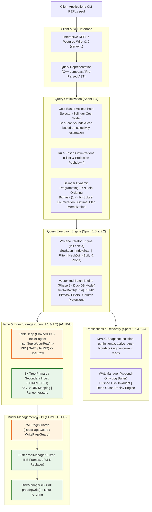

# The Pragmatic DBMS Implementation Roadmap
### An 80/20 High-ROI Blueprint for Building a Database Engine from Scratch
**Synchronized with CMU 15-445 (Intro to DB Systems) & CMU 15-721 (Advanced DB Systems)**

---

## 1. Executive Summary & The 80/20 Learning Principle

Building a relational database from scratch is one of the ultimate computer systems milestones. However, students and engineers frequently burn out or get stuck for months in low-level accidental complexity that yields little architectural insight.

```
       LOW-YIELD TOIL (SKIP / SIMPLIFY)               HIGH-ROI GOLD CORE (BUILD THIS)
 ┌──────────────────────────────────────────────┐    ┌──────────────────────────────────────────────┐
 │ • Custom SQL AST parsers & lexers            │    │ • RAII Page Guards (Page pin/unpin safety)   │
 │ • Arbitrary variable-length byte defrag      │    │ • Fixed-Size TableHeap connected to B+ Tree  │
 │ • ARIES Compensation Log Records (CLRs)      │    │ • Volcano Iterators + In-Memory Hash Join    │
 │ • Hierarchical 2PL Lock Escalation (IS/IX)   │ => │ • Cost-Based Access Path Selector (Selinger) │
 │ • LLVM IR bytecode runtime generation        │    │ • MVCC Snapshot Isolation (xmin/xmax)        │
 │ • 10-table dynamic programming join trees    │    │ • WAL Flush Invariant & Redo Crash Replay    │
 │ • Worst-Case Optimal Joins (WCOJ)            │    │ • Vectorized 1024-Batch SIMD Engine (DuckDB) │
 └──────────────────────────────────────────────┘    └──────────────────────────────────────────────┘
```

### The Core Philosophy: Mental Models Over Accidental Complexity
1. **Focus on Core Invariants**: The real genius of databases lies in:
   - How indices locate storage records (`Key -> RID`).
   - How iterators stream data through memory (Volcano pull vs Vectorized push).
   - How hash joins eliminate $O(N \times M)$ quadratic blowups.
   - Why optimizers choose an index scan over a sequential scan based on selectivity.
   - How MVCC enables non-blocking concurrent readers.
   - Why WAL write-ordering (`page_lsn <= flushed_lsn`) guarantees durability.
2. **Eliminate Low-Yield Toil**:
   - Don't write a SQL lexer/parser from scratch; use C++ lambdas or embed a battle-tested parser (`libpg_query` / DuckDB parser).
   - Don't spend 3 weeks debugging variable-length byte-packing and page defragmentation; use a fixed-width schema (`UserRow`) to master the slotted-page contract.
   - Don't implement full ARIES rollback undo chains with CLRs; implement the WAL invariant and redo crash replay.
   - Don't build raw LLVM IR generation; build vectorized 1024-tuple batch processing with SIMD bitmasks (DuckDB architecture).

---

## 2. Current Implementation Baseline

The project repository (`/home/omar/Learning Projects/db-internals`) has already mastered the hardest storage primitives:

| Subsystem | Source Components | Architectural Features | Status |
| :--- | :--- | :--- | :--- |
| **Disk Manager** | [`disk_manager.cpp`](file:///home/omar/Learning%20Projects/db-internals/buffer_pool_manager_skeleton/disk_manager.cpp)<br/>[`async_disk_manager.cpp`](file:///home/omar/Learning%20Projects/db-internals/buffer_pool_manager_skeleton/async_disk_manager.cpp)<br/>[`io_uring_manager.cpp`](file:///home/omar/Learning%20Projects/db-internals/buffer_pool_manager_skeleton/io_uring_manager.cpp) | Synchronous 4KB block `pread`/`pwrite` + Linux `io_uring` batched submission/completion ring. | **100% PASSED** (4/4 tests) |
| **Buffer Pool Manager** | [`buffer_pool_manager.cpp`](file:///home/omar/Learning%20Projects/db-internals/buffer_pool_manager_skeleton/buffer_pool_manager.cpp)<br/>[`lru_k_replacer.cpp`](file:///home/omar/Learning%20Projects/db-internals/buffer_pool_manager_skeleton/lru_k_replacer.cpp)<br/>[`page.h`](file:///home/omar/Learning%20Projects/db-internals/buffer_pool_manager_skeleton/page.h) | Fixed 4KB frames, LRU-K ($K=2$) backward distance eviction, pin/unpin frame discipline, dirty page flushing. | **100% PASSED** (All suites) |
| **B+ Tree Storage Index** | [`b_plus_tree.h`](file:///home/omar/Learning%20Projects/db-internals/btree/b_plus_tree.h)<br/>[`b_plus_tree_leaf_page.h`](file:///home/omar/Learning%20Projects/db-internals/btree/b_plus_tree_leaf_page.h)<br/>[`b_plus_tree_internal_page.h`](file:///home/omar/Learning%20Projects/db-internals/btree/b_plus_tree_internal_page.h)<br/>[`b_plus_tree_iterator.h`](file:///home/omar/Learning%20Projects/db-internals/btree/b_plus_tree_iterator.h) | **12 Milestones Complete**: Slotted nodes, dynamic split/merge, range iterators, Lehman-Yao B-link high keys, optimistic latch crabbing, ghost tombstones. | **100% PASSED** (12/12 suites, 16-thread stress test) |
| **Networking Base** | [`server.c`](file:///home/omar/Learning%20Projects/db-internals/server.c)<br/>[`threaded_server.c`](file:///home/omar/Learning%20Projects/db-internals/threaded_server.c) | Multi-threaded POSIX TCP socket server with worker pools. | **VERIFIED** |
| **Table Storage & Heaps** | *Pending* (`src/storage/table/`) | Slotted-page `TableHeap`, fixed-size tuple serialization, `RID = {page_id, slot_id}`. | **Sprint 1.2** (Immediate Next) |
| **Query Execution** | *Pending* (`src/execution/`) | Volcano Iterator (`Init`/`Next`), `SeqScan`, `IndexScan`, in-memory `HashJoin`. | **Sprint 1.3** |
| **Query Optimizer** | *Pending* (`src/optimizer/`) | Cost-based access path selection (Index vs SeqScan), filter pushdown, Selinger Dynamic Programming (DP) join ordering. | **Sprint 1.4** |
| **Concurrency & WAL** | *Pending* (`src/concurrency/`, `src/recovery/`) | MVCC Snapshot Isolation (`xmin`/`xmax`), WAL append log, redo crash replay. | **Sprint 1.5 & 1.6** |
| **Vectorized OLAP** | *Pending* (`src/olap/`) | Columnar storage, 1024-batch SIMD vector processing (DuckDB model), morsel scheduling. | **Phase 2** |

---

## 3. End-to-End System Architecture Blueprint



---

## 4. Lecture Synchronization & Implementation Curriculum

```
┌────────────────────────────────────────────────────────────────────────────────────────┐
│ PHASE 1: PRAGMATIC OLTP ENGINE (CMU 15-445)                                            │
├─────────┬──────────────────────────────────┬─────────────────────────────┬─────────────┤
│ SPRINT  │ SUBSYSTEM / MILESTONE            │ CMU 15-445 LECTURES         │ VALUE TIER  │
├─────────┼──────────────────────────────────┼─────────────────────────────┼─────────────┤
│ Sp 1.1  │ RAII Page Guards & Storage Guard │ Lecture #05 & #06 (BPM)     │ FOUNDATION  │
│ Sp 1.2  │ Fixed TableHeap & B+Tree Hookup  │ Lecture #03 & #04 (Storage) │ CORE PRIORITY│
│ Sp 1.3  │ Volcano Iterators & Hash Join    │ Lecture #12 & #13 (Exec)    │ CORE PRIORITY│
│ Sp 1.4  │ Cost-Based Optimizer (Selinger)  │ Lecture #15 & #16 (Optimizer│ HIGH VALUE  │
│ Sp 1.5  │ MVCC Snapshot Isolation          │ Lecture #17, #18, #20 (MVCC)│ CORE PRIORITY│
│ Sp 1.6  │ WAL Invariant & Redo Replay      │ Lecture #21 & #22 (Recovery)│ CORE PRIORITY│
│ Sp 1.7  │ Interactive SQL Serving (PgWire) │ Lecture #02 & #14 (Systems) │ HIGH VALUE  │
└─────────┴──────────────────────────────────┴─────────────────────────────┴─────────────┘

┌────────────────────────────────────────────────────────────────────────────────────────┐
│ PHASE 2: ADVANCED OLAP ENGINE (CMU 15-721)                                             │
├─────────┬──────────────────────────────────┬─────────────────────────────┬─────────────┤
│ SPRINT  │ SUBSYSTEM / MILESTONE            │ CMU 15-721 LECTURES         │ VALUE TIER  │
├─────────┼──────────────────────────────────┼─────────────────────────────┼─────────────┤
│ Sp 2.1  │ Columnar Storage & PAX Layout    │ Lecture #02 & #03 (Storage) │ HIGH VALUE  │
│ Sp 2.2  │ Vectorized 1024-Batch SIMD Engine│ Lecture #04 & #05 (Vector)  │ ADVANCED CORE│
│ Sp 2.3  │ Morsel-Driven Multicore Schedule │ Lecture #08 & #09 (Parallel)│ HIGH VALUE  │
└─────────┴──────────────────────────────────┴─────────────────────────────┴─────────────┘
```

---

## 5. Detailed Sprint Specifications

### Sprint 1.1: Storage Consolidation & RAII Page Guards
* **Lecture**: CMU 15-445 Lecture #05 & #06 (Buffer Pools & Memory Management)
* **Objective**: Eliminate buffer pool pin leaks and latch deadlocks permanently before building upper layers.
* **Deliverables**:
  - `BasicPageGuard`: RAII wrapper that automatically unpins the underlying frame when falling out of scope.
  - `ReadPageGuard` & `WritePageGuard`: RAII wrappers acquiring `page->RLatch()` / `page->WLatch()` on construction and dropping them on destruction.
* **What to Build**: Clean C++ move-semantics (`operator=`, move constructors) preventing multiple guards on the same pin.
* **What to Skip**: Complex multi-frame deadlock graph detectors. RAII scope discipline prevents 99% of page leaks.
* **Verification Test**: `PageGuardTest`: Acquire 100 guards in a tight loop across 8 threads; verify pin count returns to 0 on loop exit.

---

### Sprint 1.2: Fixed-Size TableHeap & B+ Tree Tuple Hookup
* **Lecture**: CMU 15-445 Lecture #03 & #04 (Database Storage Part 1 & 2)
* **Objective**: Connect the working B+ Tree to physical heap pages to execute real record insertions and point lookups.
* **Deliverables**:
  - `RID`: Record identifier struct `{page_id_t page_id, uint32_t slot_num}`.
  - `UserRow`: Clean fixed-width struct:
    ```cpp
    struct UserRow {
        int64_t id;          // Primary Key
        char name[32];       // In-line fixed string
        double balance;      // Fixed float
        uint64_t created_at; // Timestamp
        bool is_deleted;     // Tombstone flag
    };
    ```
  - `TablePage`: 4KB frame with fixed slot directory growing downwards and tuples stored at indexed offsets.
  - `TableHeap`: Chained list of `TablePage`s managed via `BufferPoolManager`.
  - **The Crucial Hookup**: Instantiate `BPlusTree<int64_t, RID>`. On `TableHeap::InsertTuple(row)`, capture the returned `RID` and insert `(row.id, RID)` into the B+ Tree.
* **What to Build**: Slotted header with bitmask/offsets, `InsertTuple`, `GetTuple(RID)`, `UpdateTuple`, `MarkDelete(RID)`.
* **What to Skip**: Arbitrary variable-length type engines (VARCHAR, TEXT, JSON, DECIMAL) and dynamic on-page compaction defragmentation.
* **Why This Matters**: Connecting an index to a heap is the fundamental leap from an abstract algorithm to a functioning database.
* **Verification Test**: `TableHeapBTreeTest`: Insert 50,000 rows into `TableHeap`; verify `BPlusTree::GetValue(id)` returns exact `RID` and retrieves the identical row.

---

### Sprint 1.3: The Volcano Execution Engine & Relational Joins
* **Lecture**: CMU 15-445 Lecture #13 (Query Execution) & Lecture #12 (Join Algorithms)
* **Objective**: Master the iterator execution model and build the most important analytical algorithm in history: the Hash Join.
* **Deliverables**:
  - `AbstractExecutor`: Pure virtual interface defining `Init()`, `Next(UserRow* out_row, RID* out_rid) -> bool`.
  - `SeqScanExecutor`: Iterates over `TableHeap` pages, yielding live records.
  - `IndexScanExecutor`: Uses B+ Tree point search or range iterator to fetch matching `RID`s and load tuples from `TableHeap` in $O(\log N)$ time.
  - `FilterExecutor`: Evaluates a predicate lambda (e.g. `[](const UserRow& r) { return r.balance > 1000.0; }`) over child executor.
  - **HashJoinExecutor (Equi-Join)**:
    - *Build Phase*: Drains the inner child executor into an in-memory hash table (`std::unordered_multimap<int64_t, UserRow>`).
    - *Probe Phase*: Pulls rows from the outer child, probes the hash table, and yields matching combinations.
* **What to Build**: Clean iterator pipeline streaming rows one tuple at a time; in-memory hash join.
* **What to Skip**: Dynamic expression evaluator AST trees (use C++ lambdas) and disk-spilling external merge sort joins.
* **Why This Matters**: Volcano powers SQLite, PostgreSQL, and MySQL. The Hash Join eliminates $O(N \times M)$ nested loop quadratic blowups.
* **Verification Test**: `HashJoinTest`: Join 5,000 users with 20,000 orders; verify Hash Join runs in milliseconds compared to seconds for Nested Loops.

---

### Sprint 1.4: Cost-Based Optimizer & Dynamic Programming (DP) Join Ordering
* **Lecture**: CMU 15-445 Lecture #15 & #16 (Query Optimization Part 1 & 2)
* **Objective**: Master the mathematical cost models and dynamic programming algorithms that determine single-table access path selection and multi-table optimal join ordering.
* **Deliverables**:
  - Table Statistics: Maintain total row count $N$, page count $P$, and distinct key count $V(A)$ for indexed columns.
  - Selectivity Estimation: Uniform distribution models for equality ($1 / V(A)$) and ranges ($(high - low) / (max - min)$).
  - Cost Model:
    - **SeqScan Cost**: $C_{\text{seq}} = P \times \text{Cost}_{\text{page\_seq}} + N \times \text{Cost}_{\text{cpu\_tuple}}$.
    - **IndexScan Cost**: $C_{\text{idx}} = (h + \lceil \text{sel} \times P_{\text{leaf}} \rceil) \times \text{Cost}_{\text{page\_seq}} + (\text{sel} \times N) \times \text{Cost}_{\text{page\_random}} + (\text{sel} \times N) \times \text{Cost}_{\text{cpu\_tuple}}$.
    - **NestedLoopJoin Cost**: $C_{\text{nlj}} = C_{\text{outer}} + |Outer| \times C_{\text{inner}} + (|Outer| \times |Inner|) \times \text{Cost}_{\text{cpu\_join}}$.
    - **HashJoin Cost**: $C_{\text{hj}} = C_{\text{outer}} + C_{\text{inner}} + |Outer| \times \text{Cost}_{\text{hash\_build}} + |Inner| \times \text{Cost}_{\text{hash\_probe}} + |Joined| \times \text{Cost}_{\text{cpu\_emit}}$.
  - Access Path Selector: Compare $C_{\text{seq}}$ vs $C_{\text{idx}}$ given query selectivity $\text{sel}$.
    - If $\text{sel} < 2\%$ (point lookup / narrow range): Choose `IndexScan`.
    - If $\text{sel} > 25-30\%$ (broad range): Choose `SeqScan` (sequential streaming beats random I/O thrashing!).
  - Rule-Based Filter Pushdown: Push filter predicates below joins directly into scan operators.
  - **Dynamic Programming (DP) Join Ordering (The Selinger / System R Algorithm)**:
    - Represent relations as bitmasks ($1 \ll i$).
    - Bottom-up subset enumeration ($k = 1 \dots N$ over $2^N - 1$ subproblems):
      - Size 1: Pick the cheapest single-relation access path for each table.
      - Size 2 to $N$: For each subset $S$, partition into $S_1 \subset S$ and $S_2 = S \setminus S_1$. Evaluate candidate physical join operators (`HashJoin` vs `NestedLoopJoin`), compute intermediate cardinality and cost, and memoize the optimal plan for $S$.
    - Pruning: Eliminate suboptimal join permutations at each subset state ($O(3^N)$ submask DP instead of $O(N!)$ factorial explosion).
    - Output the global minimum-cost physical execution plan tree.
* **What to Build**: Mathematical cost formulas, access path crossover selector, filter pushdown rule, and $N$-table bitmask Dynamic Programming join order optimizer.
* **What to Skip**: Complex multi-dimensional hyper-graph partitioning for 50+ tables (greedy heuristics / genetic algorithms); non-uniform histogram spline interpolation (assume uniform distribution $\text{sel} = 1 / V(A)$).
* **Why This Matters**: The query optimizer is the "brain" of a relational database. It prevents catastrophic $O(N!)$ join order blunders and random disk I/O thrashing.
* **Verification Test**: `OptimizerDPTest`: Verify access path crossover (0.1% picks IndexScan, 40% picks SeqScan), filter pushdown reduces scanned rows, and 3-way/4-way DP join ordering produces the optimal physical plan tree in microseconds.

---

### Sprint 1.5: Concurrency Control: MVCC Snapshot Isolation
* **Lecture**: CMU 15-445 Lecture #17, #18, #20 (Concurrency Control & MVCC)
* **Objective**: Implement Multi-Version Concurrency Control so readers never block writers and writers never block readers.
* **Deliverables**:
  - Tuple Version Header: Augment `UserRow` with `int64_t xmin` (creating txn ID) and `int64_t xmax` (deleting txn ID, 0 if alive).
  - Transaction Manager: Assigns monotonically increasing `txn_id`. Maintains `active_txn_set`.
  - Snapshot Creation: When transaction $T$ begins, capture `Snapshot = {T.id, active_txns}`.
  - Visibility Rule: A row is visible to transaction $T$ if:
    1. `row.xmin <= T.id` AND `row.xmin` was committed when $T$ started.
    2. `row.xmax == 0` OR `row.xmax > T.id` OR `row.xmax` belongs to an uncommitted transaction.
  - Non-blocking Reads: `SeqScan` and `IndexScan` evaluate visibility without taking shared read locks.
* **What to Build**: Append-only snapshot visibility rules and non-blocking reads.
* **What to Skip**: Multi-granularity hierarchical lock escalation (IS/IX/S/X tables); out-of-line rollback segments / undo log pointer chains.
* **Why This Matters**: MVCC is the foundation of PostgreSQL, Oracle, and MySQL InnoDB.
* **Verification Test**: `MVCCTest`: Thread A starts a long table scan; Thread B updates 500 rows. Thread A sees the exact snapshot from when it started with zero lock contention.

---

### Sprint 1.6: WAL Invariant & Redo Crash Replay
* **Lecture**: CMU 15-445 Lecture #21 & #22 (Logging & Crash Recovery)
* **Objective**: Master the physical write-ahead logging invariants that guarantee durability without data loss.
* **Deliverables**:
  - `LogRecord`: Struct with `{lsn_t lsn, txn_id_t txn_id, LogRecordType type, page_id_t page_id, uint32_t slot_num, UserRow before_image, UserRow after_image}`.
  - `LogManager`: Append-only in-memory log buffer flushed to disk upon transaction commit. Maintains `flushed_lsn`.
  - **The Cardinal WAL Rule**: In `BufferPoolManager::FlushPage(page_id)`:
    $$\text{ASSERT}(page\to\text{page\_lsn} \le log\_manager\to\text{flushed\_lsn})$$
    A dirty page can NEVER hit disk until its corresponding log record has been flushed!
  - Redo Crash Replay: On restart, read WAL sequentially from start to end; if `record.lsn > page.page_lsn`, re-apply `after_image`.
* **What to Build**: The cardinal WAL flush invariant check, commit log flush, and sequential redo replay.
* **What to Skip**: ARIES 3-pass recovery with Compensation Log Records (CLRs) and partial rollback undo chains.
* **Why This Matters**: The WAL invariant is the single most critical invariant in all of data engineering.
* **Verification Test**: `CrashRecoveryTest`: Insert 1,000 rows, crash the process without flushing dirty buffer pool pages, run Redo Replay; verify all 1,000 rows are intact.

---

### Sprint 1.7: Interactive SQL & Client Interface
* **Lecture**: CMU 15-445 Lecture #02 & #14
* **Objective**: Upgrade the networking server (`threaded_server.c`) into an interactive query interface.
* **Deliverables**:
  - Simple Interactive CLI / REPL supporting:
    - `INSERT INTO users VALUES (1, 'Alice', 100.0);`
    - `SELECT * FROM users WHERE id = 1;`
    - `SELECT * FROM users JOIN orders ON users.id = orders.user_id;`
  - Optional: PostgreSQL Wire Protocol v3.0 handshake (`StartupMessage`, `Query`, `RowDescription`, `DataRow`, `CommandComplete`).
* **Why This Matters**: Allows connecting standard tools (`psql` CLI, Python scripts, DBeaver) directly to your database.
* **Verification Test**: Connect via terminal and query live records interactively.

---

## 6. Phase 2: High-Performance OLAP Engine (CMU 15-721)

Once Phase 1 is complete, transition to modern in-memory analytical engines:

### Sprint 2.1: Columnar Storage & PAX Layout
* **Lecture**: CMU 15-721 Lecture #02 & #03 (Modern Storage & Memory Layouts)
* **Design**: Store data column-at-a-time (`ColumnChunk<int64_t> ids`, `ColumnChunk<double> balances`).
* **Optimization**: Dictionary encoding for repeated string values; Run-Length Encoding (RLE) for sorted columns.

### Sprint 2.2: Vectorized 1024-Batch SIMD Execution (The DuckDB Model)
* **Lecture**: CMU 15-721 Lecture #04 & #05 (Vectorized Execution & Compilation)
* **Design**: Replace tuple-at-a-time Volcano iteration with 1024-element columnar batches:
  ```cpp
  struct VectorBatch {
      int64_t ids[1024];
      double balances[1024];
      uint64_t selection_mask; // 64-bit bitmask of matching tuples
      uint16_t size;
  };
  ```
* **SIMD Optimization**: AVX2 / AVX-512 filter evaluation processing 4 to 8 elements per CPU instruction cycle.
* **Benchmark Target**: Scan bandwidth exceeds 5 GB/sec per core.

### Sprint 2.3: Morsel-Driven Multicore Parallelism
* **Lecture**: CMU 15-721 Lecture #08 & #09 (Parallel Query Execution)
* **Design**: Lock-free work-stealing queue dividing table pages into fixed morsels (e.g., 10,000 rows per task). Worker threads grab morsels and build thread-local hash tables before a parallel merge.

---

## 7. Target Benchmarks & Verification Suite

| Benchmark Name | Query Shape | Primary Metric | Target Performance |
| :--- | :--- | :--- | :--- |
| **Point Index Scan** | `WHERE id = 42` | Latency ($\mu$s) | $< 5\ \mu\text{s}$ (B+ Tree traversal to `TableHeap`) |
| **Hash Join** | `Users JOIN Orders ON u.id = o.user_id` | Throughput (rows/sec) | $> 500,000\ \text{rows/sec}$ ($100\times$ faster than nested loops) |
| **MVCC Snapshot Read** | Concurrent scan during 10 update threads | Lock Contention | **Zero lock stalls** (readers never block writers) |
| **Crash Recovery** | Unclean kill & WAL Redo Replay | Integrity | **100% data recovery** with zero page corruption |
| **Vectorized Scan (OLAP)** | `SELECT SUM(balance) WHERE balance > 50` | Scan Bandwidth | $> 2.0\ \text{GB/sec}$ on single thread |

---

## 8. Immediate 48-Hour Action Plan

```
┌────────────────────────────────────────────────────────────────────────────────────────┐
│ DAY 1: STORAGE SAFETY & FIXED SCHEMA FOUNDATION                                         │
├─────────┬──────────────────────────────────────────────────────────────────────────────┤
│ Step 1  │ Implement ReadPageGuard and WritePageGuard in `src/storage/page_guard.h`.     │
│ Step 2  │ Define the fixed `UserRow` and `RID` structs in `src/storage/table_page.h`.  │
│ Step 3  │ Build `TablePage` 4KB slotted frame with insert, get, and tombstone delete.  │
├─────────┼──────────────────────────────────────────────────────────────────────────────┤
│ DAY 2: TABLEHEAP & B+ TREE HOOKUP                                                      │
├─────────┼──────────────────────────────────────────────────────────────────────────────┤
│ Step 4  │ Implement `TableHeap` spanning multiple pages via `BufferPoolManager`.       │
│ Step 5  │ Hook up `BPlusTree<int64_t, RID>` as the primary index in `TableHeap::Insert`.│
│ Step 6  │ Write `TableHeapBTreeTest`: Insert 50,000 rows and verify point lookups!     │
└─────────┴──────────────────────────────────────────────────────────────────────────────┘
```

---

## 9. Deliverable Summary & PDF Download

The complete publication-grade PDF version of this roadmap has been compiled and typeset:
* **PDF File**: [`DBMS_Implementation_Roadmap.pdf`](file:///home/omar/Learning%20Projects/db-internals/DBMS_Implementation_Roadmap.pdf) (9 Pages, high-resolution formatting, exact sprint cards, code samples, benchmark tables, and CMU lecture alignment).
* **Generator Script**: [`build_dbms_roadmap_pdf.py`](file:///home/omar/Learning%20Projects/db-internals/build_dbms_roadmap_pdf.py).
