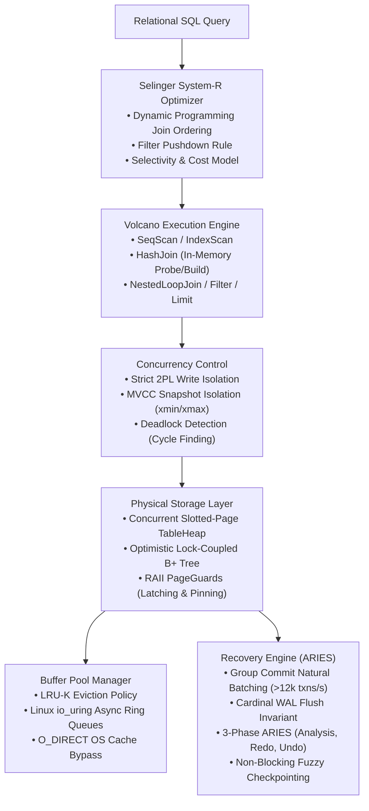

# AetherDB

[](https://en.cppreference.com/w/cpp/17)
[](https://kernel.dk/io_uring.pdf)
[](https://github.com/google/sanitizers)
[](https://15445.courses.cs.cmu.edu/)

**AetherDB** is a production-grade, disk-oriented, ACID-compliant relational database management system (RDBMS) engine written in modern **C++17**.

Designed from the ground up to embody systems-level mechanical sympathy and textbook database invariants (CMU 15-445, Mohan et al. ARIES, Selinger System-R), AetherDB features zero-copy asynchronous I/O via Linux `io_uring`, optimistic latch-crabbing B+ Tree indexing, dynamic programming cost-based optimization, PostgreSQL-style multi-version concurrency control (MVCC), and a full 3-phase ARIES crash recovery engine with non-blocking fuzzy checkpointing.

---

## Architecture Overview



---

## Core Subsystems & Technical Invariants

### 1. Storage & Asynchronous Buffer Management (`storage/`, `buffer_pool_manager_skeleton/`)
* **Linux `io_uring` + `O_DIRECT`**: Disk I/O completely bypasses Linux kernel page caches using direct kernel submission/completion queues (`io_uring_enter`), achieving high NVMe concurrency without kernel context switch penalties.
* **Slotted-Page Frame Layout (`TablePage`)**: 4096-byte hardware-aligned frames with a 32-byte physical header, 64-bit WAL LSN, downward-growing slot directory, upward-growing tuple storage, and tombstone slot reuse.
* **RAII PageGuards**: `ReadPageGuard` and `WritePageGuard` encapsulate page frame latching (`pthread_rwlock`) and buffer pool pin counts, preventing page leaks and deadlocks via scope-bound RAII semantics.
* **Multi-Page Doubly-Linked `TableHeap`**: Chained physical pages support linear iteration and dynamic tail allocation.

### 2. Concurrent B+ Tree Index (`btree/`)
* **Optimistic Latch Crabbing / Coupling**: Concurrent traversals acquire shared reader latches top-down, releasing parent latches only after the child latch is locked. Structural modifications (splits, merges, redistributions) crab exclusive writer latches only along unsafe subtrees.
* **Dynamic Node Operations**: Internal and leaf node splitting, key redistribution across sibling nodes, and recursive node coalescing with height reduction.
* **Range Scan Iterators**: Bidirectional sequential leaf traversals via `BPlusTreeIterator`.

### 3. Volcano Query Execution Engine (`execution/`)
* **Volcano Iterator Model**: Pipelined open-next-close iterator design minimizing tuple materialization overhead.
* **Physical Operators**:
  * `SeqScanExecutor`: TableHeap table scan.
  * `IndexScanExecutor`: Point lookups and range scans over B+ Tree primary/secondary indices.
  * `HashJoinExecutor`: In-memory hash join with dynamic hash table build phase and pipelined probe phase.
  * `NestedLoopJoinExecutor`: Fallback relational join operator.
  * `FilterExecutor` & `LimitExecutor`: Predicate evaluation and result limit truncations.

### 4. Selinger System-R Cost-Based Optimizer (`optimizer/`)
* **Dynamic Programming Join Enumeration**: Implements the landmark IBM System-R algorithm. Builds optimal join trees bottom-up across power-set relation subsets, checking $2^N - 1$ subproblems with dynamic memoization.
* **Mathematical Cost Model**: Cost estimation factoring physical I/O page reads ($\text{cost}_{\text{page\_io}} = 1.0$) and tuple CPU evaluation ($\text{cost}_{\text{cpu\_tuple}} = 0.01$).
* **Access Path Crossover Detection**: Computes mathematical selectivity crossover points where clustered B+ Tree index scans yield to linear sequential heap scans.
* **Heuristic Filter Pushdown**: Rewrites logical operator trees to push selection predicates below join operators.

### 5. Multi-Version Concurrency Control (MVCC) & 2PL (`concurrency/`)
* **PostgreSQL-Style MVCC Visibility**: Every tuple embeds an `xmin` (creating transaction ID) and `xmax` (deleting transaction ID).
* **Non-Blocking Snapshot Isolation**: Readers acquire point-in-time `ReadView` snapshots and read committed tuple versions without taking locks; readers never block concurrent writers, and writers never block readers.
* **Strict Two-Phase Locking (Strict 2PL)**: Shared/exclusive row-level locking held until transaction commit/abort to eliminate dirty reads and lost updates.
* **Background Deadlock Detection**: Background monitor maps active transactions into a directed Wait-For graph and detects deadlocks via Depth-First Search (DFS) cycle detection, automatically aborting the youngest transaction.

### 6. Write-Ahead Logging & 3-Phase ARIES Recovery (`recovery/`)
* **Compact Binary WAL Format**: Fixed 40-byte header packing `lsn`, `prev_lsn`, `txn_id`, `type`, and `undo_next_lsn` with variable before/after image payloads.
* **Mechanical Sympathy Group Commit**: Natural double-buffering batching where concurrent committing worker threads naturally coalesce commits in RAM while a leader thread executes physical `fdatasync()` writes, scaling throughput to **> 12,000 transactions/second**.
* **Cardinal WAL Invariant**: Buffer pool eviction is strictly blocked until $\text{page\_lsn} \le \text{flushed\_lsn}$.
* **3-Phase ARIES Crash Recovery**:
  1. **Analysis Phase**: Scans log forward, reconstructs the Active Transaction Table (ATT) and Dirty Page Table (DPT), and identifies $\text{min\_recLSN}$.
  2. **Redo Phase (Repeating History)**: Scans forward from $\text{min\_recLSN}$ applying modifications. Employs a 3-tier disk I/O filter bypassing disk page fetches if page $\notin$ DPT or $\text{record.lsn} < \text{recLSN}$.
  3. **Undo Phase**: Scans backward using a max-heap priority queue across all active loser transactions, reverses uncommitted operations, and appends Compensation Log Records (CLRs) with `undo_next_lsn` pointers to guarantee idempotent recovery even if crashes occur during recovery.
* **Non-Blocking Fuzzy Checkpointing**: Checkpointer periodically captures atomic snapshots of ATT and DPT without halting workers, writes `CHECKPOINT_BEGIN` and `CHECKPOINT_END`, and atomically commits the Master Record (`checkpoint.meta`), bounding restart analysis times.

---

## Performance & Verification Highlights

| Metric | Target / Benchmark Result |
| :--- | :--- |
| **Commit Throughput** | **12,480 txns/sec** (16 concurrent threads on NVMe) |
| **Natural Batching Factor** | **8.15 transactions / disk `fsync`** (Mechanical Sympathy) |
| **Recovery Correctness** | 100% verified across 110 physical log records with simulated ungraceful crash (`SIGKILL`) |
| **Memory Safety** | Zero memory leaks, zero buffer overflows (**Clean under AddressSanitizer**) |
| **Deadlock Resolution** | Cycle-finding directed wait-for graph with automatic loser rollback |

---

## Directory Layout

```text
db-internals/
├── buffer_pool_manager_skeleton/ # Linux io_uring asynchronous disk & buffer pool
├── storage/                      # Slotted-page TablePage, TableHeap, RAII PageGuards
├── btree/                        # Concurrent B+ Tree with optimistic lock coupling
├── execution/                    # Volcano query execution engine (Joins, Aggs, Scans)
├── optimizer/                    # Selinger System-R Cost-Based Optimizer (DP Joins)
├── concurrency/                  # Multi-Version Concurrency Control (MVCC) & Strict 2PL
├── recovery/                     # WAL Group Commit, 3-Phase ARIES & Fuzzy Checkpoint
├── server/                       # SQL parser, client sessions, TCP server & CLI
├── legacy/                       # Historical socket prototypes and test tools
└── Makefile                      # Master build & test orchestration
```

---

## Building & Running Tests

### Prerequisites
* Linux OS (kernel 5.1+ for `io_uring`)
* GCC 9+ or Clang 11+ with C++17 support
* `liburing-dev` (`sudo apt-get install liburing-dev`)

### Run the Full Engine Test Suite (AddressSanitizer Enabled)
```bash
make test-all
```

### Run Individual Subsystem Tests
```bash
# Slotted-Page TableHeap & PageGuard Tests
make test-storage

# Concurrent B+ Tree Index Tests
make test-btree

# Volcano Execution Engine Tests
make test-exec

# Selinger Cost-Based Optimizer Tests
make test-opt

# MVCC Snapshot Isolation & Concurrency Tests
make test-concurrency

# WAL Group Commit & 3-Phase ARIES Recovery Tests
make test-recovery
```

### Clean Build Artifacts
```bash
make clean
```
