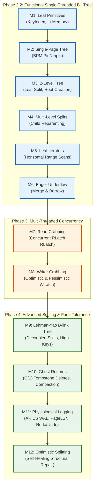

# On-Disk B+ Tree Skeleton & Testing Roadmap

This is a comprehensive engineering roadmap for building an on-disk, highly concurrent, and crash-resilient B+ Tree storage engine.
It progresses from baseline single-threaded slotted page mechanics (Phase 2.2) to multi-threaded latch crabbing (Phase 3), and culminates in modern high-concurrency B-link trees, ghost records, optimistic splitting, and physiological logging (Phase 4).
The design follows the CMU 15-445 BusTub architecture and maps directly to Goetz Graefe's *Modern B-Tree Techniques* (2011) and Lehman & Yao (1981).

---

## Files Included

1. `b_plus_tree_page.h`:
   Represents the 24-byte base header shared by all B+ tree pages on disk (`page_type_`, `size_`, `max_size_`, `parent_page_id_`, `page_id_`, `lsn_`).
2. `b_plus_tree_leaf_page.h`:
   Physical byte layout for leaf pages storing sorted `(Key, Value)` pairs alongside `next_page_id_` and `prev_page_id_` sibling pointers.
3. `b_plus_tree_internal_page.h`:
   Physical byte layout for internal routing nodes storing separator keys and child `page_id_t` pointers.
4. `b_plus_tree.h`:
   High-level index coordinator connecting tree algorithms (search, insertion, split propagation, deletion, and underflow handling) to the `BufferPoolManager`. Contains `struct Context` for latch crabbing sets.
5. `b_plus_tree_iterator.h`:
   RAII sequential scan iterator providing forward range traversals across leaf page boundaries.
6. `b_plus_tree_test.cpp`:
   Test harness with dedicated targets (`make test1` through `make test12` or `make test`).
7. `Makefile`:
   Build automation configured with `-std=c++17 -Wall -Wextra -g -fsanitize=address -O2` and `-luring -pthread`.

---

## Core Invariants & Rules

Before writing any code, keep these foundational database storage rules in mind:

1. **Zero-Copy In-Memory Page Overlay**:
   All node classes are overlaid directly on raw 4KB memory frames (`page->GetData()`). You do not allocate nodes with `new`; you fetch frames via `BufferPoolManager::FetchPage` and `BufferPoolManager::NewPage`, then `reinterpret_cast`.
2. **Buffer Pool Pin Count Discipline**:
   Every single `FetchPage()` or `NewPage()` call **must** have an exact matching `UnpinPage(page_id, is_dirty)`. Leaking pins will quickly cause out-of-memory errors once the buffer pool fills up.
3. **Internal Node Key / Pointer Alignment**:
   In an internal node of size $N$, there are $N$ valid child pointers (`ValueAt(0)` to `ValueAt(N-1)`) and $N-1$ valid separator keys (`KeyAt(1)` to `KeyAt(N-1)`). `KeyAt(0)` is always dummy/invalid.
4. **Child Reparenting Invariant**:
   Whenever child pointers move to another internal node (during a split, merge, or borrow), every adopted child page must be fetched and its `parent_page_id_` updated to point to its new parent.
5. **Split Differences (Leaf vs. Internal)**:
   - **Leaf Split**: The separator key pushed up to the parent is *copied* (it must remain in the leaf node as well).
   - **Internal Split**: The middle separator key pushed up to the parent is *moved* (it is removed from the internal node).
6. **Latch Coupling (Crabbing) Discipline**:
   Always acquire a child latch before releasing the parent latch. Always pin a page before latching it, and unlatch it before unpinning it. In reader crabbing, parent `RLatch()` is released as soon as child `RLatch()` is acquired. In writer crabbing, ancestor `WLatch()`es are held in `Context::write_set_` and only released when a child node is verified "safe" (cannot split on insert or underflow on delete).
7. **B-link High Key & Right-Link Invariant**:
   In a B-link tree, every node (leaf and internal) maintains a `high_key_` (the highest key in that subtree) and a `right_link_` pointer. When a node splits, it links right immediately. Any traversal encountering `search_key > high_key_` navigates horizontally across transient neighbor pointers without needing to lock or re-traverse parents.
8. **Ghost Record Deletion Invariant**:
   Modern B-trees avoid synchronous physical deletion and underflow rebalancing. Instead, deletions mark a slot with a ghost tombstone bit. This enables $O(1)$ deletes, prevents cascading tree rebalancing deadlocks, and allows instant transaction rollbacks. Slot compaction is deferred to page reorganization.
9. **Physiological Logging & WAL Invariant**:
   All page mutations are logged via physiological log records (physical page identifier, logical page operation). The page LSN (`page->SetLSN(lsn)`) must be monotonically updated, and log records must be flushed to disk before the corresponding page frame is written out (`page_lsn <= flushed_lsn`).

---

## Milestone-by-Milestone Implementation & Testing Guide

You can test your work incrementally at each stage using targeted make targets (`make test1`, `make test2`, etc.):

---

### Milestone 1: Leaf Node Mechanics (`b_plus_tree_leaf_page.h`)
*Focus: Graefe (2011) Section 2.1 & 2.2*

#### Tasks to Implement:
1. `KeyIndex(key, comparator)`: Binary search returning index of first key $\ge \text{search key}$.
2. `Lookup(key, result, comparator)`: Locate key using `KeyIndex`, check equivalence, copy to `*result`, return `true`/`false`.
3. `Insert(key, value, comparator)`: Reject duplicates, shift elements right, insert at index, return new size.
   > [!IMPORTANT]
   > To check if `key` is a duplicate at `insertion_idx`, check equivalence:
   > `!comparator(key, array_[insertion_idx].first)` (since `KeyIndex` already guarantees `array_[idx].first >= key`).
4. `RemoveAndDeleteRecord(key, comparator)`: Locate key, shift elements left, decrement size, return new size.

#### How to Test:
Run the dedicated Milestone 1 test:
```bash
make test1
```
#### What `test1` Verifies:
- Executes purely in-memory on a stack buffer without needing disk I/O.
- Verifies `KeyIndex` on empty leaf returns 0.
- Inserts keys out-of-order (`30`, `10`, `20`) and asserts sorted order `[ 10, 20, 30 ]`.
- Asserts duplicate insertion of `20` returns `-1` and preserves size.
- Verifies point `Lookup()` for existing keys and non-existing boundary keys.
- Verifies deletion of `20` shifts elements and updates size to `2`.

#### What You Gain From This Milestone:
A self-contained, slotted page byte layout for leaf nodes. You master binary search (`KeyIndex`), shift-based sorted insertions, point lookups, and deletions in raw memory completely decoupled from disk and buffer managers.

---

### Milestone 2: Single-Page Tree Engine (`b_plus_tree.h`)
*Focus: Graefe (2011) Section 2.3*

#### Tasks to Implement:
1. `StartNewTree(key, value)`:
   - Allocate new root page via `bpm_->NewPage(&root_page_id_)`.
   - Cast `page->GetData()` to `LeafPage*`, call `leaf->Init(root_page_id_, INVALID_PAGE_ID, leaf_max_size_)`.
   - Call `leaf->Insert(key, value, comparator_)`.
   - Unpin root page with `is_dirty = true`.
2. `FindLeafPage(key)`:
   - For a single-page tree (before internal nodes exist), fetch `root_page_id_` and return the pinned `Page*`.
3. `GetValue(key, result)`:
   - Call `FindLeafPage(key)`.
   - Call `leaf->Lookup(key, &val, comparator_)`. If found, `result->push_back(val)`.
   - Unpin leaf page with `is_dirty = false`.
4. `Insert(key, value)`:
   - If `IsEmpty()`, call `StartNewTree(key, value)` and return `true`.
   - Otherwise, fetch leaf via `FindLeafPage(key)`, call `leaf->Insert(key, value, comparator_)`, and unpin leaf with `is_dirty = true`.

#### How to Test:
```bash
make test2
```
#### What `test2` Verifies:
- Inserts keys into a tree with capacity 10 (no splits triggered).
- Verifies `GetValue()` retrieves all inserted values.
- Asserts duplicate insertion returns `false`.
- Asserts searching for missing keys returns `false`.
- Verifies that zero page pins are leaked in the Buffer Pool Manager.

#### What You Gain From This Milestone:
The crucial bridge between raw in-memory page layouts and the `BufferPoolManager`. You gain a functioning single-page key-value index with strict pin/unpin lifecycle discipline, zero frame leaks, and fundamental point query operations (`GetValue` and `Insert`).

---

### Milestone 3: Leaf Splitting, Root Creation & Tree Traversal (`b_plus_tree_leaf_page.h`, `b_plus_tree_internal_page.h`, `b_plus_tree.h`)
*Focus: Graefe (2011) Section 3.11*

#### Tasks to Implement:
1. `BPlusTreeLeafPage::Split(recipient_id, recipient)`:
   - Move upper half of key/value pairs to `recipient`.
   - Splice sibling pointers: `recipient->next = leaf->next`, `recipient->prev = leaf->page_id`, `leaf->next = recipient_id`.
2. `BPlusTreeInternalPage::Populate(val0, key1, val1)`:
   - Initialize internal root with child 0, middle key 1, and child 1.
3. `BPlusTree::InsertIntoParent(old_page, key, new_page)` (Root Creation):
   - If `old_page` is root: allocate new internal root page, call `Populate()`, reparent both children to new root, update `root_page_id_`.
4. Update `BPlusTree::InsertIntoLeaf`:
   - If `leaf->GetSize() >= leaf->GetMaxSize()`: allocate recipient page, call `leaf->Split()`, update next sibling's `prev_page_id`, push separator key `recipient->KeyAt(0)` to parent via `InsertIntoParent()`.
5. `BPlusTreeInternalPage::Lookup(key, comparator)`:
   - Binary search over `array_[1 ... GetSize() - 1]` to find child pointer to descend.
   - If search key is strictly smaller than `KeyAt(1)`, descend into child 0 (`ValueAt(0)`).
   - Otherwise, find the largest key $\le \text{search key}$ and return that child pointer.
6. Update `BPlusTree::FindLeafPage(key)`:
   - Descend tree from root: loop `while (!curr_node->IsLeafPage())`, using `internal->Lookup()` to descend levels, unpinning parent pages with `dirty = false` on the way down.
7. Update `BPlusTree::GetValue(key, result)`:
   - Cast `leaf_page->GetData()` to `LeafPage*`, append to result if found, and unpin `leaf_page` on all code paths (`dirty = false`).
8. `BPlusTreeInternalPage::InsertNodeAfter(old_val, key, new_val)`:
   - Locate index of `old_val` via `ValueIndex`.
   - Shift items from `GetSize()` down to `old_idx + 1` right by 1 slot: `array_[i] = array_[i - 1]`.
   - Insert `{key, new_val}` at `old_idx + 1`, call `IncreaseSize(1)`, and return updated size.
   - *Why needed here*: In `test3`, inserting 7 keys triggers a second leaf split (when key 70 is added). `InsertIntoParent` must insert this 3rd leaf into the existing internal root without overflowing it.

#### How to Test:
```bash
make test3
```
#### What `test3` Verifies:
- Inserts 7 keys with `leaf_max_size = 4` and `internal_max_size = 4`.
- Triggers leaf split and root creation, producing a 2-level tree.
- Traverses through the internal root to insert subsequent keys (50, 60, 70).
- Inserts the 3rd leaf into the existing internal root via `InsertNodeAfter`.
- Verifies all 7 keys can be fetched and point lookups succeed.
- Calls `PrintTree()` to visually display levels:
  ```text
  Level 0: [Int 2 (size 3): 30 50 ] 
  Level 1: [Leaf 0 (size 2): 10 20 ] [Leaf 1 (size 2): 30 40 ] [Leaf 3 (size 3): 50 60 70 ]
  ```

#### What You Gain From This Milestone:
Tree growth and hierarchical navigation! The tree breaks the single-page boundary to become a dynamic 2-level index. You gain leaf horizontal linking (doubly linked sibling pointers for fast range scans), internal root creation upon leaf overflow, and top-down routing traversal from root to leaf via separator keys.

---

### Milestone 4: Multi-Level Internal Splits (`b_plus_tree_internal_page.h` & `b_plus_tree.h`)
*Focus: Graefe (2011) Section 2.3 & 3.11*

#### Tasks to Implement:
1. `BPlusTreeInternalPage::Split(recipient_id, recipient, split_key)`:
   - Move upper half of entries to `recipient`, set `*split_key = KeyAt(split_idx)` (separator promoted up).
   - **Clean Layering Invariant**: Page operations remain purely in-memory. In `BPlusTree::InsertIntoParent`, loop over all child pointers adopted by `recipient` and reparent them via `ReparentChild(child_page_id, recipient_page_id)`.
2. In `BPlusTree::InsertIntoParent`:
   - If parent overflows (`parent->GetSize() > parent->GetMaxSize()`), allocate new internal page, split parent, reparent recipient's children, and recurse upward.
   - Ensure proper unpinning of both parent and recipient pages.

#### How to Test:
```bash
make test4
```
#### What `test4` Verifies:
- Inserts **5,000 randomized keys** into the B+ tree.
- Verifies tree growth across multiple internal node levels.
- Checks every key against an in-memory oracle (`std::map<int64_t, int64_t>`).

#### What You Gain From This Milestone:
Arbitrary depth scalability. When internal routing nodes themselves fill up, splits propagate upward recursively all the way to the root. You gain child reparenting invariants and an enterprise-grade index that handles thousands to millions of keys across 3, 4, or more levels.

---

### Milestone 5: Leaf Iterators & Range Scans (`b_plus_tree_iterator.h` & `b_plus_tree.h`)
*Focus: Lehman-Yao (1981); Graefe (2011) Section 4.6*

#### Tasks to Implement:
1. `operator*()`: Returns `leaf->GetItem(index_)`.
2. `operator++()`:
   - Increment `index_`.
   - If `index_ >= leaf->GetSize()`: read `leaf->GetNextPageId()`, unpin current page (`dirty = false`), fetch next page, reset `index_ = 0`.
3. `BPlusTree::Begin()`: Traverse down child 0 to leftmost leaf, return `Iterator(bpm_, leftmost_id, 0)`.
4. `BPlusTree::Begin(key)`: Find leaf for `key`, locate index via `KeyIndex`, return `Iterator`.

#### How to Test:
```bash
make test5
```
#### What `test5` Verifies:
- Inserts 100 items spanning multiple leaf pages.
- Scans full range `tree.Begin()` to `tree.End()`, asserting strictly sorted sequential order.
- Scans partial range `tree.Begin(42)` to verify lower-bound start points.
- Asserts zero buffer pool frame leaks as iterators cross page boundaries.

#### What You Gain From This Milestone:
High-performance range query scans (`SELECT * WHERE key BETWEEN a AND b`). You gain an STL-compliant C++ forward iterator that traverses horizontally across leaf sibling pointers, seamlessly crossing 4KB physical disk page boundaries with zero buffer pool frame leaks.

---

### Milestone 6: Deletions, Merging & Redistribution (`b_plus_tree.h`, leaf & internal pages)
*Focus: Graefe (2011) Section 2.3 & 3.10*

#### Tasks to Implement:
1. In leaf and internal pages (pure in-memory array operations):
   - `MergeInto`: Merge entries into left sibling (`left_sibling`).
   - `LendFirstTo` / `LendLastTo`: Borrow entries from sibling (redistribution). In internal nodes, these return the moved child `page_id_t`.
2. In `BPlusTree` (I/O, pinning, and reparenting):
   - `ReparentChild(child_page_id, new_parent_page_id)`: Helper that fetches child, sets parent pointer, and unpins dirty.
   - `HandleUnderflow`: Main dispatcher for underflow handling when size drops below `GetMinSize()`.
   - `MergeNodes`: Merges `right_page` into `left_page`, reparents adopted internal children, and deletes `right_page`.
   - `BorrowFromLeft` / `BorrowFromRight`: Sibling borrowing across parent separator key; reparents borrowed internal child.
   - `TryCollapseRoot`: Collapse tree height if internal root drops to 1 child pointer or leaf root drops to 0 keys.

#### How to Test:
```bash
make test6
```
#### What `test6` Verifies:
- Inserts keys 1 through 10.
- Deletes keys 1, 3, 5, 7, 9, triggering node merges, borrowing, and root collapses.
- Asserts deleted keys are gone, and remaining keys (`2, 4, 6, 8, 10`) are intact.

#### What You Gain From This Milestone:
Dynamic space reclamation and height shrinking. When records are deleted and nodes underflow below 50% capacity, siblings borrow entries (redistribution) or merge (coalescing), and empty roots collapse to prevent sparse disk pages and preserve $O(\log N)$ tree height guarantees.

---

## Phase 3: Multi-Threaded Concurrency & Latch Crabbing

In Phase 3, you make the B+ tree thread-safe, enabling simultaneous readers and writers across multiple worker threads using Latch Crabbing (Coupling) via `struct Context` in `b_plus_tree.h` and `Page::rwlatch_` in `page.h`.

---

### Milestone 7: Concurrent Readers via Read Crabbing (`b_plus_tree.h`, `page.h`, `Context`)
*Focus: CMU 15-445 Latch Crabbing; Graefe (2011) Section 4.1*

#### Tasks to Implement:
1. **Root Pointer Protection**:
   - Protect access to `root_page_id_` with a lightweight mutex/latch (or tree-level read-write latch) so readers do not fetch an invalid root during root creation or collapse.
2. **Read Crabbing in `FindLeafPage(key, ctx)`**:
   - Step 1: Fetch root page via `bpm_->FetchPage(root_page_id_)`.
   - Step 2: Acquire read latch: `curr_page->RLatch()`. If tracking via `Context`, push to `ctx->read_set_`.
   - Step 3: Descend the tree level-by-level:
     - Read separator routing keys to find child `next_page_id`.
     - Fetch child: `next_page = bpm_->FetchPage(next_page_id)`.
     - **Crabbing step**: Acquire read latch on child: `next_page->RLatch()`.
     - **Safe release**: Since reading a node cannot cause structural splits or merges, the child is *always safe*. Immediately release parent read latch (`curr_page->RUnlatch()`) and unpin parent (`bpm_->UnpinPage(curr_page->GetPageId(), false)`).
     - `curr_page = next_page`.
   - Step 4: Return pinned and read-latched leaf `Page*`.
3. **Update `GetValue(key, result, ctx)`**:
   - Obtain read-latched leaf page from `FindLeafPage(key, ctx)`.
   - Cast to `LeafPage*`, perform binary search via `leaf->Lookup()`.
   - Release leaf read latch (`leaf_page->RUnlatch()`) and unpin leaf (`bpm_->UnpinPage(leaf_page->GetPageId(), false)`).

#### How to Test:
```bash
make test7
```
#### What `test7` Verifies:
- Builds a multi-level tree with 10,000 keys.
- Spawns **16 concurrent reader threads** continuously executing randomized point lookups.
- Verified under **ThreadSanitizer** (`-fsanitize=thread`): asserts zero data races and zero latch leaks.
- Asserts that all 10,000 keys are successfully and consistently read across threads.
- Asserts zero buffer pool frame pin leaks.

#### What You Gain From This Milestone:
Deadlock-free, parallel read scalability. Multiple readers navigate down the hierarchy concurrently without blocking each other, holding read latches for only microseconds per level during the crabbing descent.

---

### Milestone 8: Concurrent Writers via Latch Crabbing & Optimistic Coupling (`b_plus_tree.h`, `Context`)
*Focus: Graefe (2011) Section 4.2 & CMU 15-445 Concurrency Control*

#### Tasks to Implement:
1. **Pessimistic Latch Crabbing Protocol (Insert & Delete)**:
   - Acquire write latch on the tree root lock.
   - Fetch root page, acquire `root_page->WLatch()`, push to `ctx->write_set_`.
   - Descend toward target leaf:
     - For each child node: fetch child page, acquire `child_page->WLatch()`.
     - **Check Node Safety**:
       - On `Insert`: A node is **safe** if `child->GetSize() < child->GetMaxSize() - 1` (inserting an entry cannot trigger a split).
       - On `Delete`: A node is **safe** if `child->GetSize() > child->GetMinSize()` (deleting an entry cannot trigger underflow).
     - **Release Ancestors**: If child is safe, release write latches on all ancestor pages held in `ctx->write_set_` and unpin them (`bpm_->UnpinPage(page_id, false)`). Empty `ctx->write_set_` and add `child_page`.
     - If child is not safe: retain all ancestor write latches in `ctx->write_set_`.
   - At the leaf: perform insertion or deletion. If a split or merge propagates upward, all ancestor nodes required for the mutation are already write-latched.
   - Cleanup: `ctx->Clear(bpm_, is_dirty = true)` unlatches and unpins all remaining pages.
2. **Optimistic Latch Crabbing (Performance Upgrade)**:
   - 99% of inserts do not trigger splits!
   - Optimistic pass: Descend with **read crabbing** (`RLatch`) down to the leaf page.
   - At the leaf, acquire `leaf->WLatch()`.
   - Check if leaf is safe: if `leaf->GetSize() < leaf->GetMaxSize() - 1`, execute the insert, release `leaf->WLatch()`, unpin, and return immediately without ever taking write latches on ancestors!
   - If leaf is full, abort optimistic pass, drop latches, and fallback to pessimistic `WLatch` crabbing.

#### How to Test:
```bash
make test8
```
#### What `test8` Verifies:
- Spawns **8 concurrent writer threads** and **8 concurrent reader threads** simultaneously inserting, updating, deleting, and searching keys across overlapping key ranges.
- Asserts strict serializable correctness against a synchronized thread-safe test oracle.
- Verified under **ThreadSanitizer** (`-fsanitize=thread`): validates zero deadlocks, zero race conditions, and zero lost updates.

#### What You Gain From This Milestone:
Enterprise-grade concurrent B+ Tree execution. Readers and writers coexist safely without tree corruption or lock deadlocks, while optimistic crabbing reduces root-level contention to near zero.

---

## Phase 4: Advanced Modern B-Tree Scaling & Fault Tolerance
*Based on Goetz Graefe's "Modern B-Tree Techniques" (2011), Lehman & Yao (1981), and ARIES (Mohan et al., 1992)*

In Phase 4, you elevate the storage engine from textbook latch-crabbing B+ trees to state-of-the-art database engine internals used in high-throughput engines like Microsoft SQL Server, PostgreSQL, and WiredTiger.

---

### Milestone 9: Lehman-Yao B-link Trees (Decoupled Node Splits via Transient Neighbor Pointers)
*Focus: Lehman & Yao (1981); Graefe (2011) Section 4.4 & 4.5*

#### Background & Motivation:
In standard B+ trees, even with latch crabbing, splits propagating upward require exclusive write latches on ancestor nodes, choking concurrency at higher tree levels. Lehman & Yao's **B-link Tree** decouples child node splits from parent node updates using **high keys** and **transient right-neighbor pointers**.

```text
Before Split:
[ Node A: 10, 20, 30, 40 | High Key: 50 | Right: Node C ]

Step 1 (Split Node A into A and B, link right IMMEDIATELY):
[ Node A: 10, 20 | High Key: 30 | Right: Node B ] ---> [ Node B: 30, 40 | High Key: 50 | Right: Node C ]
*(Split is already fully navigable by concurrent readers BEFORE parent is modified!)*

Step 2 (Asynchronously insert split separator 30 into parent):
[ Parent: ... 30 ... ]
```

#### Tasks to Implement:
1. **Node Layout Upgrade (`b_plus_tree_page.h`, leaf & internal pages)**:
   - Add `high_key_` to both leaf and internal nodes: defines the maximum separator key belonging to this node or its subtree.
   - Ensure `next_page_id_` (right-link pointer) exists on **both internal and leaf nodes**.
2. **Decoupled Split Protocol**:
   - Step 1: Allocate new right sibling page $B$ via `bpm_->NewPage(&b_page_id)`.
   - Step 2: Move upper half of entries from $A$ to $B$.
   - Step 3: Set $B$'s `right_link_ = A->GetNextPageId()` and $B$'s `high_key_ = A->GetHighKey()`.
   - Step 4: Set $A$'s `right_link_ = b_page_id` and $A$'s `high_key_ = split_key`.
   - Step 5: **Immediately unlatch and unpin Node $A$!** The split is now logically visible and structurally consistent.
   - Step 6: Asynchronously or lazily climb to parent to insert `(split_key, b_page_id)`.
3. **Horizontal Right-Link Traversal**:
   - During any downward traversal, if `search_key > curr_node->GetHighKey()`, follow `curr_node->GetNextPageId()` horizontally to the right sibling.
   - Readers and writers never miss keys and never need upward write locks during splits!

#### How to Test:
```bash
make test9
```
#### What `test9` Verifies:
- Massive concurrent insertion test where internal splits occur continuously.
- Confirms concurrent reader threads never encounter read pauses or stale misses while parent pointers are delayed or in-flight.
- Zero root write locks acquired during internal node splits.

#### What You Gain From This Milestone:
True lock-free descent. Internal node splits become localized operations between two sibling frames, eliminating tree-wide split contention and enabling linear multicore scale.

---

### Milestone 10: Ghost Records for Deletes & Asynchronous Space Reclamation
*Focus: Graefe (2011) Section 3.1 & 3.10*

#### Background & Motivation:
Synchronous underflow rebalancing (Milestone 6) causes cascading merges, reverse-direction latching (holding parent, left sibling, and current node), and severe deadlock risks. Modern engines (SQL Server, Postgres, InnoDB) solve this by using **Ghost Records** (tombstones).

```text
Slot Array:
[ Slot 0: Key 10, Val 100 ] [ Slot 1: Key 20, Val 200 (GHOST BIT = 1) ] [ Slot 2: Key 30, Val 300 ]
- Key 20 is logically deleted in O(1) time.
- No shifting. No immediate node merge.
- Re-inserting Key 20 reuses Slot 1 in-place.
- Space compacted asynchronously during page reorg.
```

#### Tasks to Implement:
1. **Ghost Bit Representation**:
   - Add a 1-bit tombstone flag per slot in `b_plus_tree_leaf_page.h` (using a bitset or high bit of entry metadata).
2. **O(1) In-Place Deletions (`Remove(key)`)**:
   - Perform binary search via `KeyIndex(key)`.
   - If found and not already a ghost, set `is_ghost = true` and decrement live count.
   - **Do not shift elements or trigger immediate merges**. Return immediately.
3. **Ghost Slot Reuse upon Insertion (`Insert(key, value)`)**:
   - If inserting a key that matches an existing ghost record, revive the slot: overwrite the value, clear `is_ghost = false`, and increment live count.
4. **Range Scan Filtering (`b_plus_tree_iterator.h`)**:
   - Advance iterator past any slot where `is_ghost == true`.
5. **Page Compaction / Defragmentation**:
   - Implement `LeafPage::Compact()`: Reorganizes the page by purging ghost records and shifting active records to reclaim contiguous free space when `Insert()` requires space and page has dead ghost records.
   - Background vacuum worker hook to coalesce empty leaf pages asynchronously without blocking transaction critical paths.

#### How to Test:
```bash
make test10
```
#### What `test10` Verifies:
- Verifies deletion executes in $O(\log N)$ search + $O(1)$ bit flip without array shifting.
- Inserts 1,000 keys, deletes 500 keys, and asserts that range scan iterator returns exactly the 500 live keys in sorted order.
- Re-inserts deleted keys and verifies zero memory allocations by reusing ghost slots.
- Fills page with ghosts, triggers `Compact()`, and validates complete space reclamation.

#### What You Gain From This Milestone:
Elimination of underflow deadlocks, microsecond delete latency, instant transaction rollback capability (simply flip the ghost bit back), and high-throughput MVCC compatibility.

---

### Milestone 11: Physiological Logging & ARIES Crash Recovery
*Focus: C. Mohan et al. (ARIES, 1992); Gray & Reuter (1993); Graefe (2011) Section 5*

#### Background & Motivation:
Physical logging (logging entire 4KB pages) creates massive I/O write amplification. Pure logical logging requires complex inverse undo operations. Modern databases use **Physiological Logging**: *physical addressing to a page, logical operation within the page*.

```text
Log Record:
[ LSN: 1042 | PrevLSN: 1010 | TxnID: 7 | PageID: 45 | Type: LOG_INSERT | Key: 50 | Val: 500 ]
                               |
                               v
                     Target Disk Frame: Page 45
                     [ Header: PageLSN = 1042 | ... data ... ]
```

#### Tasks to Implement:
1. **Physiological Log Record Architecture**:
   - Define log records with fields: `{lsn_t lsn, lsn_t prev_lsn, txn_id_t txn_id, page_id_t page_id, LogRecordType type, payload}`.
   - Types: `LOG_INSERT`, `LOG_GHOST_DELETE`, `LOG_SPLIT`, `LOG_SET_HIGH_KEY`, `LOG_REPARENT`.
2. **Page LSN Discipline**:
   - Every mutation updates the page header: `page->SetLSN(current_log_lsn)`.
   - **Write-Ahead Logging (WAL) Invariant**: Enforce in `BufferPoolManager::FlushPage(page_id)`:
     `disk_manager_->FlushLog(page->GetLSN())` must complete **before** writing the 4KB data page to disk (`page_lsn <= flushed_lsn`).
3. **ARIES Three-Pass Recovery Engine**:
   - **Analysis Pass**:
     - Scan log from last checkpoint forward.
     - Identify all active (uncommitted) transactions and determine dirty pages (`recLSN`).
   - **Redo Pass (Repeating History)**:
     - Scan forward from minimum `recLSN`.
     - For each log record: if `record.lsn > page->GetLSN()`, re-execute the physiological operation on the page and advance `page->SetLSN(record.lsn)`.
   - **Undo Pass**:
     - Roll back active uncommitted transactions in reverse LSN order.
     - Undo inserts by marking slots as ghost records (generating Compensation Log Records - CLRs).

#### How to Test:
```bash
make test11
```
#### What `test11` Verifies:
- Generates 10,000 transactions with random inserts and ghost deletes.
- Injects a simulated hard crash (`SIGKILL`) during active splits and page updates.
- Re-launches the system, invokes `RecoveryEngine::Recover()`, and checks 100% data consistency against an oracle database.

#### What You Gain From This Milestone:
ACID Durability and crash resilience. Your storage engine can survive unexpected power outages or operating system crashes without index corruption or lost data.

---

### Milestone 12: Optimistic Splitting & Resilient Recovery
*Focus: Graefe (2011) Section 4.3 & 5.3*

#### Background & Motivation:
What happens if the system crashes or a thread aborts *after* a node has split and linked to its sibling, but *before* the parent routing pointer is updated? An industrial-grade B-link tree must handle this condition gracefully through **Optimistic Splitting & Self-Healing Structural Repair**.

```text
Crash Window during Split:
1. Node A split into A and B (A->right = B, A->high_key = 30)  [PERSISTED TO DISK]
2. System crashes / restarts BEFORE parent is updated!         [CRASH EVENT]
3. Parent still only points to Node A.
4. Post-recovery traversal:
   Search for Key 35 descends to Node A.
   Node A observes: 35 > high_key (30) -> Follows right-link to Node B (Found!).
   Traversal notices missing parent link -> Automatically schedules self-healing repair!
```

#### Tasks to Implement:
1. **Two-Phase Optimistic Split Protocol**:
   - Phase 1 (Localized Frame Split): Populate new sibling frame $B$, update $A$'s right-link and high key under local page latches, and flush WAL record `LOG_SPLIT`.
   - Phase 2 (Parent Installation): Schedule parent router installation. If parent split occurs, proceed upward.
2. **Traversal-Driven Self-Healing Structural Repair**:
   - In `FindLeafPage(key)`: If horizontal navigation via `right_link_` is required to reach the target key, detect if the parent router is missing.
   - Trigger asynchronous repair task to install the separator key into the parent node, completing the split without requiring full offline index reconstruction.
3. **Fault-Tolerant Sibling Splicing**:
   - Ensure doubly linked leaf pointers (`prev_page_id_` and `next_page_id_`) are updated with idempotent WAL operations so recovery never creates circular pointer references.

#### How to Test:
```bash
make test12
```
#### What `test12` Verifies:
- Deliberately injects process terminations immediately after Phase 1 of a leaf split (leaving the parent node un-updated).
- Restarts the database, performs point lookups and range scans, and confirms that queries correctly navigate through transient neighbor links.
- Verifies that subsequent writes automatically repair the parent routing entry on-the-fly.

#### What You Gain From This Milestone:
Production-ready structural fault tolerance. Decoupled splits cannot cause database corruption even under catastrophic mid-split crashes.

---

## Architectural Evolution Roadmap



---

### Running All Tests at Once

Run individual milestone suites:
```bash
make test1   # Leaf node primitives
make test2   # Single-page tree
make test3   # Leaf split & root creation
make test4   # Scale random inserts (5,000 keys)
make test5   # Sequential range iterator
make test6   # Eager deletions & underflow
make test7   # Concurrent readers (16 threads)
make test8   # Concurrent readers & writers (Latch crabbing)
make test9   # Lehman-Yao B-link decoupled splits
make test10  # Ghost records & page compaction
make test11  # Physiological logging & ARIES recovery
make test12  # Optimistic splitting & crash self-repair
```

Run all functional unit tests sequentially:
```bash
make test
```

Run concurrency and multi-threaded stress suites under ThreadSanitizer:
```bash
make test_tsan
```
