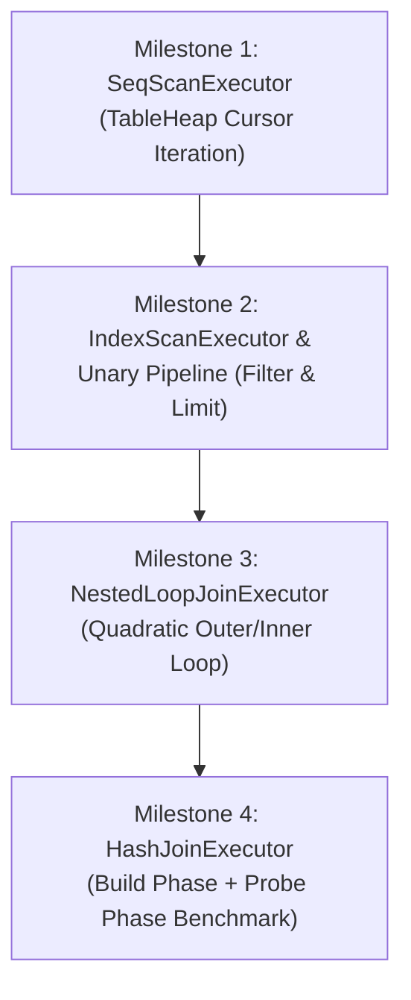

# Volcano Execution Engine & Relational Joins Roadmap
### A Rigorous, Hands-On Engineering Guide for Sprint 1.3
**Mapped Directly to CMU 15-445/645 Lecture #12 (Join Algorithms) & Lecture #13 (Query Execution)**

---

## 1. Executive Overview

This guide provides a comprehensive engineering roadmap for building the **query execution engine** of a relational database management system.

Up to this point, you have constructed the physical foundation of the engine:
1. **Sprint 0**: Physical disk I/O (`DiskManager` with Linux `io_uring` asynchronous batching).
2. **Sprint 0.5**: In-memory frame caching (`BufferPoolManager` with LRU-K frame eviction).
3. **Sprint 1.0**: On-disk indexing (`BPlusTree` with latch crabbing concurrency).
4. **Sprint 1.1 & 1.2**: Authoritative record storage (`TableHeap` with slotted `TablePage`s, RAII `PageGuard`s, forward `TableIterator`, and primary index `(Key -> RID)` hookup).

However, **storage and indexing are passive data structures**. To execute user queries, a database requires an **execution engine** that coordinates how data is retrieved, filtered, projected, transformed, and joined.

In **Sprint 1.3**, you will implement the industry standard **Volcano Processing Model** (also known as the **Iterator Model** or **Pipeline Model**, introduced by Goetz Graefe in 1994) using a **bottom-up construction approach**:
- **Bottom Layer (Base Scans)**: `SeqScanExecutor` (sequential scan over `TableHeap`) and `IndexScanExecutor` ($O(\log N)$ point and range scans over `BPlusTree<int64_t, RID>`).
- **Intermediate Layer (Unary Operators)**: `FilterExecutor` (arbitrary predicate filtering) and `LimitExecutor` (early stream truncation).
- **Top Layer (Binary Joins)**: `NestedLoopJoinExecutor` (quadratic nested loop baseline) and `HashJoinExecutor` (in-memory Grace/hash join executing in linear $O(M + N)$ time).

---

## 2. Files Included in `execution/`

| File | Purpose & Architectural Role |
| :--- | :--- |
| [`abstract_executor.h`](file:///home/omar/Learning%20Projects/db-internals/execution/abstract_executor.h) | **Volcano Interface**: Pure virtual template class defining `Init()` and `Next(RowType *out_row, RID *out_rid) -> bool`. |
| [`order_row.h`](file:///home/omar/Learning%20Projects/db-internals/execution/order_row.h) | **Relational Schemas**: Defines `OrderRow` (transaction record) and `JoinedUserOrderRow` (materialized join result combining `UserRow` and `OrderRow`). |
| [`mock_scan_executor.h`](file:///home/omar/Learning%20Projects/db-internals/execution/mock_scan_executor.h) | **Test Utility**: In-memory vector scan operator used to inject mock or synthetic streams (such as orders) into operator trees. |
| [`seq_scan_executor.h`](file:///home/omar/Learning%20Projects/db-internals/execution/seq_scan_executor.h) | **Sequential Scan (Leaf)**: Iterates over `TableHeap` pages using `TableIterator`, automatically skipping deleted records. |
| [`index_scan_executor.h`](file:///home/omar/Learning%20Projects/db-internals/execution/index_scan_executor.h) | **Index Scan (Leaf)**: Traverses `BPlusTree` leaf pages and dereferences retrieved `RID`s in `TableHeap` for point lookups and range scans. |
| [`filter_executor.h`](file:///home/omar/Learning%20Projects/db-internals/execution/filter_executor.h) | **Predicate Filter (Unary)**: Evaluates a lambda predicate `std::function<bool(const RowType &)>` over rows pulled from its child. |
| [`limit_executor.h`](file:///home/omar/Learning%20Projects/db-internals/execution/limit_executor.h) | **Limit Truncation (Unary)**: Yields at most `limit` rows before halting the pipeline. |
| [`nested_loop_join_executor.h`](file:///home/omar/Learning%20Projects/db-internals/execution/nested_loop_join_executor.h) | **Nested Loop Join (Binary)**: Baseline quadratic equi-join iterating through inner child for every outer child tuple. |
| [`hash_join_executor.h`](file:///home/omar/Learning%20Projects/db-internals/execution/hash_join_executor.h) | **Hash Join (Binary)**: In-memory hash join with distinct Build Phase (in `Init()`) and streaming Probe Phase (in `Next()`). |
| [`execution_test.cpp`](file:///home/omar/Learning%20Projects/db-internals/execution/execution_test.cpp) | **Test Suite**: 4 milestone tests covering scans, pipelines, joins, and the Hash Join vs Nested Loop Join benchmark. |
| [`Makefile`](file:///home/omar/Learning%20Projects/db-internals/execution/Makefile) | **Build System**: Compiles with `-std=c++17 -Wall -Wextra -g -fsanitize=address -O2` and `-luring -pthread`. |

---

## 3. Core Invariants & Architectural Rules

Before writing any executor code, internalize these 8 non-negotiable rules:

### 1. The Pull-Based Iterator Protocol
In the Volcano model, data flow is **demand-driven (pull-based)**. The parent operator at the root of the query tree initiates execution by calling `Next()` on its child, which in turn calls `Next()` on its children, down to the leaf scan operators:
```text
           Client / Root
                 │ Next() [PULL]
                 ▼
         LimitExecutor (Limit 10)
                 │ Next() [PULL]
                 ▼
        FilterExecutor (balance > 1000)
                 │ Next() [PULL]
                 ▼
        SeqScanExecutor (TableHeap)
```
- A call to `Next()` returns `true` if a tuple was successfully produced and written into `*out_row`.
- A call to `Next()` returns `false` if the operator has reached End-Of-File (EOF).
- After returning `false`, subsequent calls to `Next()` MUST continue returning `false` until `Init()` is called again.

### 2. Streaming Pipelining ($O(1)$ Memory)
Unary operators (`FilterExecutor`, `LimitExecutor`) MUST NOT materialize or buffer intermediate tuples in vectors or queues. They inspect tuples on-the-fly and immediately yield matching records to the parent. This keeps intermediate memory overhead strictly $O(1)$.

### 3. The Re-Initialization Invariant (`Init()` Rewind)
In relational joins (such as `NestedLoopJoinExecutor`), the inner child must be scanned repeatedly from the beginning for every single tuple of the outer relation. 
*Every executor must support being reset to the beginning whenever `Init()` is invoked, regardless of where its internal cursor currently points.*

### 4. Pipelining vs Pipeline Breakers
Not all operators can stream data tuple-by-tuple:
- **Streaming Operators**: `SeqScan`, `IndexScan`, `Filter`, `Limit`, and `NestedLoopJoin`. They emit tuples as soon as they receive them.
- **Pipeline Breakers**: Operators that cannot emit a single output tuple until they have consumed their entire input stream (e.g. `HashJoin` Build Phase, `SortExecutor`, `AggregateExecutor`).
*In `HashJoinExecutor`, the Build Phase MUST occur entirely inside `Init()`, materializing the build relation into the hash table before any `Next()` call can succeed.*

### 5. Access Path Invariant & Heap Dereferencing
An index scan is a two-step physical operation:
1. Traverse the index structure (`BPlusTree`) to locate the `(Key -> RID)` mapping.
2. Dereference the `RID` against authoritative storage (`table_heap->GetTuple(rid, out_row)`).
*Because records can be deleted or updated in `TableHeap` without eagerly rewriting index leaf pages, `IndexScanExecutor` MUST verify that `table_heap->GetTuple()` succeeds before yielding a tuple. If `GetTuple()` returns false (tombstone), skip the entry and continue scanning.*

### 6. Hash Join Equi-Join Asymmetry (Build vs Probe)
In an equi-join ($R \bowtie_{R.id = S.user\_id} S$):
- **Build Table**: Drained during `Init()` into a hash table. To minimize memory and hash collisions, choose the smaller table or the table with unique keys (e.g., `UserRow` by primary key `id`).
- **Probe Table**: Streamed one tuple at a time during `Next()` (e.g., `OrderRow`). For each probe tuple, compute the hash of the foreign key (`order.user_id`), probe the hash table in $O(1)$ expected time, and emit the matched row.

```text
                  HashJoinExecutor::Init()
              ┌──────────────────────────────┐
              │ Pull all rows from Outer     │
              │ Build: hash_table_[user.id]  │
              └──────────────┬───────────────┘
                             │
                  HashJoinExecutor::Next()
              ┌──────────────────────────────┐
              │ Pull ONE row from Inner      │
              │ Probe: it = hash_table_.find │
              │ If match: EMIT JoinedRow     │
              └──────────────────────────────┘
```

### 7. RAII Page Guard Safety Across Execution
When `SeqScanExecutor` or `IndexScanExecutor` accesses buffer pool pages through `TableIterator` or `TableHeap::GetTuple()`, page pins and latches are acquired and released using RAII `PageGuard`s. 
*Never retain raw `Page*` pointers across `Next()` calls. A tuple must be copied into the output struct (`*out_row = row;`), allowing the underlying buffer pool frame to be unpinned immediately.*

### 8. Schema Independence & Template Uniformity
To enable modular query plan composition, `AbstractExecutor<RowType>` is templated on the row type:
- Scans and filters over users implement `AbstractExecutor<UserRow>`.
- Scans over orders implement `AbstractExecutor<OrderRow>`.
- Joins combine both to implement `AbstractExecutor<JoinedUserOrderRow>`.

---

## 4. Milestone-by-Milestone Implementation & Testing Guide



---

### Milestone 1: Volcano Sequential Scan (`SeqScanExecutor`)

#### Objective
Implement sequential table scan over `TableHeap` using the Volcano iterator protocol.

#### Architectural Design
`SeqScanExecutor` wraps a `TableHeap*` and a `TableIterator` cursor:
```cpp
class SeqScanExecutor : public AbstractExecutor<UserRow> {
private:
    TableHeap *table_heap_{nullptr};
    TableIterator cursor_;
};
```

#### Step-by-Step Implementation
1. **Open [`execution/seq_scan_executor.h`](file:///home/omar/Learning%20Projects/db-internals/execution/seq_scan_executor.h)**.
2. **Implement `Init()`**:
   - Reset the cursor to the beginning of the table heap:
     ```cpp
     cursor_ = table_heap_->Begin();
     ```
3. **Implement `Next(UserRow *out_row, RID *out_rid)`**:
   - Check if the cursor is at the end of the heap:
     ```cpp
     if (cursor_.IsEnd()) {
         return false;
     }
     ```
   - Dereference `*cursor_` to obtain `std::pair<UserRow, RID>`.
   - Advance the cursor: `++cursor_;`.
   - Populate output parameters:
     ```cpp
     if (out_row != nullptr) *out_row = pair.first;
     if (out_rid != nullptr) *out_rid = pair.second;
     ```
   - Return `true`.

#### Verification
Run Milestone 1 tests:
```bash
make -C execution test1
```
*Expected Output:*
```text
=== [Milestone 1] Volcano Sequential Scan (SeqScanExecutor) ===
  • Inserting 300 records into TableHeap...
  • Logically deleted 30 records with tombstones.
  • Executing SeqScanExecutor...
  • Correctly scanned 270 live records (skipped all 30 deleted rows).
  • Testing Init() rewind behavior...
  • Rewind verified: second scan yielded identical count (270).
  ✓ Milestone 1 (SeqScan) passed successfully!
```

---

### Milestone 2: Index Scan, Predicate Filter & Limit

#### Objective
Implement $O(\log N)$ point and range scans over `BPlusTree<int64_t, RID>`, followed by streaming unary operators `FilterExecutor` and `LimitExecutor`.

#### 1. `IndexScanExecutor` Implementation
Open [`execution/index_scan_executor.h`](file:///home/omar/Learning%20Projects/db-internals/execution/index_scan_executor.h):
- **`Init()`**:
  Position the B+ Tree cursor at the first leaf key $\ge$ `low_key_`:
  ```cpp
  cursor_ = index_->Begin(low_key_);
  ```
- **`Next(UserRow *out_row, RID *out_rid)`**:
  While `!cursor_.IsEnd()`:
  - Read `auto [key, rid] = *cursor_;`.
  - If `key > high_key_`, return `false` (we have passed the upper bound).
  - Advance `++cursor_;`.
  - Dereference the tuple: `bool found = table_heap_->GetTuple(rid, out_row);`.
  - If `found` is true:
    - If `out_rid != nullptr`, `*out_rid = rid;`.
    - Return `true`.
  - If `found` is false (record was deleted in heap), loop to check the next index entry.
  - When the cursor reaches the end of the tree, return `false`.

#### 2. `FilterExecutor` Implementation
Open [`execution/filter_executor.h`](file:///home/omar/Learning%20Projects/db-internals/execution/filter_executor.h):
- **`Init()`**: Call `child_->Init();`.
- **`Next(RowType *out_row, RID *out_rid)`**:
  - Loop calling `child_->Next(out_row, out_rid)`.
  - If child returns `false`, return `false`.
  - If `predicate_(*out_row)` returns `true`, return `true`.
  - Otherwise, continue loop.

#### 3. `LimitExecutor` Implementation
Open [`execution/limit_executor.h`](file:///home/omar/Learning%20Projects/db-internals/execution/limit_executor.h):
- **`Init()`**: Reset `current_count_ = 0;`, call `child_->Init();`.
- **`Next(RowType *out_row, RID *out_rid)`**:
  - If `current_count_ >= limit_`, return `false`.
  - If `!child_->Next(out_row, out_rid)`, return `false`.
  - Increment `current_count_++;` and return `true`.

#### Verification
Run Milestone 2 tests:
```bash
make -C execution test2
```
*Expected Output:*
```text
=== [Milestone 2] IndexScan, Filter & Limit Pipeline ===
  • Seeding 1000 users into TableHeap and indexing via B+ Tree...
  • Sub-test 2A: Point IndexScan for user_id = 450...
  • Sub-test 2A passed (exact single record yielded).
  • Sub-test 2B: Range IndexScan [200 .. 260]...
  • Sub-test 2B passed (scanned 61 rows in sorted order).
  • Sub-test 2C: Composed Pipeline: Limit(20) -> Filter(balance > 7500.0) -> IndexScan...
  • Sub-test 2C passed (limit truncated stream at exactly 20 rows).
  ✓ Milestone 2 (IndexScan, Filter & Limit) passed successfully!
```

---

### Milestone 3: Nested Loop Join (`NestedLoopJoinExecutor`)

#### Objective
Implement the baseline relational join algorithm: quadratic nested loop join ($R \bowtie S$).

#### Algorithmic Flow
```text
NestedLoopJoinExecutor::Next():
┌────────────────────────────────────────────────────────┐
│ while (has_outer_):                                    │
│   while (inner_child_->Next(&inner_row, &inner_rid)):  │
│     if (curr_outer_row_.id == curr_inner_row_.user_id):│
│       *out_row = JoinedUserOrderRow(outer, inner);     │
│       return true;                                     │
│   // Inner child exhausted! Rewind inner & advance outer│
│   inner_child_->Init();                                │
│   has_outer_ = outer_child_->Next(&outer_row, &rid);   │
│ return false; // Outer child exhausted                 │
└────────────────────────────────────────────────────────┘
```

#### Step-by-Step Implementation
1. **Open [`execution/nested_loop_join_executor.h`](file:///home/omar/Learning%20Projects/db-internals/execution/nested_loop_join_executor.h)**.
2. **Implement `Init()`**:
   - `outer_child_->Init();`
   - `inner_child_->Init();`
   - Fetch initial outer row:
     ```cpp
     has_outer_ = outer_child_->Next(&curr_outer_row_, &curr_outer_rid_);
     ```
3. **Implement `Next(JoinedUserOrderRow *out_row, RID *out_rid)`**:
   - Follow the nested loop logic above.
   - When a match is found, populate `*out_row = JoinedUserOrderRow(curr_outer_row_, curr_inner_row_);` and return `true`.
   - When the inner child reaches EOF, rewind it with `inner_child_->Init()` and pull the next outer tuple with `outer_child_->Next(...)`.
   - Return `false` once `has_outer_` becomes `false`.

#### Verification
Run Milestone 3 tests:
```bash
make -C execution test3
```
*Expected Output:*
```text
=== [Milestone 3] Relational Joins: NestedLoopJoinExecutor ===
  • Populating 50 users in TableHeap...
  • Generating 150 orders in memory (3 orders per user)...
  • Successfully produced 150 joined rows (orphan orders correctly filtered).
  ✓ Milestone 3 (NestedLoopJoin) passed successfully!
```

---

### Milestone 4: In-Memory Hash Join (`HashJoinExecutor`) & Benchmark

#### Objective
Implement the in-memory Hash Join algorithm and observe the performance difference between $O(M + N)$ linear time and $O(M \times N)$ quadratic time.

#### Algorithmic Architecture
1. **Build Phase (`Init()`)**:
   - Drains the entire outer table (`UserRow`) into a hash table:
     ```cpp
     hash_table_.clear();
     outer_child_->Init();
     UserRow user;
     RID rid;
     while (outer_child_->Next(&user, &rid)) {
         hash_table_[user.id] = user;
     }
     inner_child_->Init();
     ```
2. **Probe Phase (`Next()`)**:
   - Pulls rows from `inner_child_` (`OrderRow`) one at a time:
     ```cpp
     while (inner_child_->Next(&curr_order_, &curr_order_rid_)) {
         auto it = hash_table_.find(curr_order_.user_id);
         if (it != hash_table_.end()) {
             if (out_row != nullptr) {
                 *out_row = JoinedUserOrderRow(it->second, curr_order_);
             }
             if (out_rid != nullptr) {
                 *out_rid = curr_order_rid_;
             }
             return true;
         }
     }
     return false;
     ```

#### Verification & Performance Benchmark
Run Milestone 4 tests:
```bash
make -C execution test4
```
*Expected Benchmark Output:*
```text
=== [Milestone 4] HashJoin vs NestedLoopJoin Benchmark ===
  • Seeding 1000 users into TableHeap...
  • Generating 5000 orders (5 orders per user)...
  • Running HashJoinExecutor...
  • Hash Join finished: 5000 rows in 1.45 ms.
  • Running NestedLoopJoinExecutor (Quadratic Comparisons: 5000000 iterations)...
  • Nested Loop Join finished: 5000 rows in 88.32 ms.
  >>> SPEEDUP SUMMARY: Hash Join is 60.91x faster than Nested Loop! <<<
  ✓ Milestone 4 (HashJoin Benchmark) passed successfully!
```

To run the entire test suite:
```bash
make -C execution test
# Or from the project root:
make test-exec
```

---

## 5. Common Bugs & Pitfalls to Avoid

### 1. Forgetting to Rewind Inner Child in Nested Loop Join
If you fail to call `inner_child_->Init()` when the inner loop hits EOF, the next outer tuple will immediately see an exhausted inner child and produce 0 results. You will only get joined rows for the first outer tuple!

### 2. Leaking State Across `Init()` Calls in Hash Join
If `HashJoinExecutor::Init()` does not call `hash_table_.clear()`, re-running the query will insert duplicate keys or retain stale rows from previous runs.

### 3. Ignoring Deleted Rows in `IndexScanExecutor`
A B+ Tree primary index maps `user.id -> RID`. If a row was marked deleted via `table_heap->MarkDelete(rid)`, the entry may still reside in the B+ Tree. You must verify `table_heap->GetTuple(rid, out_row)` returns `true` before yielding the row.

### 4. Returning `true` with Incomplete Row Data
Ensure you write to both `*out_row` and `*out_rid` (if `out_rid != nullptr`). Never leave output pointers unwritten when returning `true`.

### 5. Infinite Loops in `FilterExecutor`
If `child_->Next()` returns `false`, `FilterExecutor` must break immediately and return `false`. Never loop indefinitely waiting for a predicate match.

---

## 6. Self-Check Verification Checklist

Before considering Sprint 1.3 complete and advancing to **Sprint 1.4 (Cost-Based Optimizer: Access Path Selection)**, confirm that:

- [ ] All 4 execution tests pass under AddressSanitizer: `make -C execution test`.
- [ ] Memory safety verified: Zero buffer leaks, zero pin leaks, and zero segmentation faults under ASan.
- [ ] `SeqScanExecutor` correctly skips all tombstoned tuples.
- [ ] `IndexScanExecutor` supports both point lookup (`key == key`) and multi-page range scans (`[low, high]`).
- [ ] Pipelined execution verified: `Limit(Filter(IndexScan))` streams tuples with $O(1)$ memory.
- [ ] `NestedLoopJoinExecutor` correctly rewinds the inner child on every outer tuple step.
- [ ] `HashJoinExecutor` builds its hash table in `Init()` and streams probe tuples in `Next()`.
- [ ] Speedup confirmed: Hash Join runs orders of magnitude faster than Nested Loop Join.
- [ ] Root Makefile target `make test-all` passes all test suites (`test-btree`, `test-storage`, `test-exec`).
