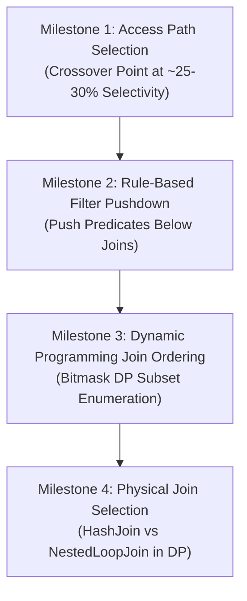

# Cost-Based Query Optimization & Dynamic Programming Join Ordering
### A Rigorous, Hands-On Engineering Guide for Sprint 1.4
**Mapped Directly to CMU 15-445/645 Lecture #15 & #16 (Query Optimization Part 1 & 2) and the Landmark 1979 System R Selinger Paper**

---

## 1. Executive Overview

This guide provides a comprehensive engineering roadmap for building the **query optimizer** of a relational database management system.

In Sprint 1.3, you implemented the Volcano Execution Engine (`SeqScanExecutor`, `IndexScanExecutor`, `FilterExecutor`, `NestedLoopJoinExecutor`, and `HashJoinExecutor`). That engine can physically execute query plans. However, **an execution engine is blind**: it executes whatever tree of operators it is handed. If a client writes:
```sql
SELECT * FROM users JOIN orders ON users.id = orders.user_id WHERE users.balance > 1000;
```
A naive engine might execute a full cartesian product first, run quadratic nested loops over millions of records, or use an index scan to retrieve 80% of a table via random disk I/O, grinding performance to a halt.

In **Sprint 1.4**, you will build the **brain of the database: the Query Optimizer**:
1. **Cost Modeling & Selectivity Estimation**: Derive exact mathematical hardware cost formulas (sequential block I/O vs random block seeks vs CPU tuple processing) to quantify execution plans.
2. **Access Path Selection**: Calculate query selectivity and mathematically determine the exact crossover point where sequential scans beat index scans.
3. **Rule-Based Optimization (RBO)**: Implement algebraic rewrite transformations such as **Filter Pushdown** (`σ_P(R ⋈ S) ≡ σ_P(R) ⋈ S`) to minimize intermediate data volumes before joins.
4. **Selinger Dynamic Programming (DP) Join Order Enumeration**: Implement Pat Selinger's landmark 1979 System R dynamic programming algorithm using **bitmask state representation `(1 << N)`**. This searches the factorial space of join permutations in `O(3^N)` time and produces the global minimum-cost physical execution tree.

---

## 2. Files Included in `optimizer/`

| File | Purpose & Architectural Role |
| :--- | :--- |
| [`statistics.h`](file:///home/omar/Learning%20Projects/db-internals/optimizer/statistics.h) | **Catalog Statistics**: Tracks table cardinalities (`N`), page counts (`P`), and per-column distinct values (`V(A)`). Calculates equality and range selectivities. |
| [`cost_model.h`](file:///home/omar/Learning%20Projects/db-internals/optimizer/cost_model.h) | **Mathematical Cost Formulations**: Implements hardware-calibrated cost formulas for `SeqScan`, `IndexScan`, `NestedLoopJoin`, and `HashJoin`. |
| [`abstract_plan_node.h`](file:///home/omar/Learning%20Projects/db-internals/optimizer/abstract_plan_node.h) | **Physical Plan Representation**: Defines tree node classes (`SeqScanPlanNode`, `IndexScanPlanNode`, `FilterPlanNode`, `JoinPlanNode`) with costs and estimated row cardinalities. |
| [`selinger_optimizer.h`](file:///home/omar/Learning%20Projects/db-internals/optimizer/selinger_optimizer.h) | **Optimizer Engine**: Implements single-table access path selection, filter pushdown rules, and bitmask Dynamic Programming join order enumeration. |
| [`optimizer_test.cpp`](file:///home/omar/Learning%20Projects/db-internals/optimizer/optimizer_test.cpp) | **Test Suite**: 4 progressive milestone tests verifying selectivity crossover, filter pushdown, DP memoization, and physical join selection. |
| [`Makefile`](file:///home/omar/Learning%20Projects/db-internals/optimizer/Makefile) | **Build System**: Compiles with `-std=c++17 -Wall -Wextra -g -fsanitize=address -O2` (`make test1` through `test4`). |

---

## 3. Core Invariants & Mathematical Formulations

Before writing optimizer code, internalize these 7 foundational mathematical principles:

### 1. The Access Path Cost Formulations

In disk-oriented relational database engines (CMU 15-445 Lecture #15), costs are normalized relative to a **sequential 4KB block read** (`Cost_page_seq = 1.0`):

#### A. Sequential Scan Cost
A sequential scan reads all `P` pages of a `TableHeap` sequentially and inspects all `N` tuples on CPU:
```
Cost_seq = (P * Cost_page_seq) + (N * Cost_cpu_tuple)
```
*Default constants*: `Cost_page_seq = 1.0`, `Cost_cpu_tuple = 0.01`.

#### B. Index Scan Cost
An index scan over a B+ Tree traverses internal router nodes down to a leaf page, scans adjacent leaf pages in the range, and **dereferences each matching RID by fetching its page from `TableHeap`**:
```
Cost_idx = Tree_Traversal_Cost + Random_IO_Cost + CPU_Cost

Where:
  Tree_Traversal_Cost = (height + ceil(sel * P_leaf)) * Cost_page_seq    [B+ Tree Traversal & Range Leaves]
  Random_IO_Cost      = (sel * N) * Cost_page_random                     [Random I/O Tuple Dereferencing]
  CPU_Cost            = (sel * N) * Cost_cpu_tuple                       [CPU Evaluation]
```
*Default constants*: `Cost_page_random = 4.0` (random I/O is ≈ 4× more expensive due to disk seek and cache misses).

### 2. The Access Path Crossover Point Principle
Why does a database "refuse" to use an index on queries like `SELECT * FROM users WHERE id > 100`?
- **Highly Selective Query (`sel = 0.01%`)**:
  Only 1 row matches. IndexScan reads 3 index pages + 1 random data page (`Cost_idx ≈ 8.01`). Sequential scan reads all 250 pages (`Cost_seq = 350.0`). **IndexScan is 43× faster!**
- **Low Selectivity Query (`sel = 60%`)**:
  6,000 rows match. IndexScan performs 6,000 random I/O lookups (`Cost_idx > 24,000`). Sequential scan still reads all 250 pages sequentially (`Cost_seq = 350.0`). **Sequential scan is 68× faster!**
- **The Crossover Point**:
  The mathematical threshold where `Cost_idx == Cost_seq` occurs at approximately **25% – 30% selectivity**. Beyond this threshold, sequential block streaming always beats random pointer dereferencing.

```text
 Cost
  ▲
  │                                      / IndexScan Cost
  │                                     /  (Dominated by Random I/O)
  │                                    /
  │                                   /
  │                      CROSSOVER   /
  │                        POINT    /
  │──────────────────────────X─────/───────── SeqScan Cost (Constant P * Cost_seq)
  │                         /│
  │                        / │
  │  IndexScan Cheaper    /  │     SeqScan Cheaper
  │  (Point & Ranges)    /   │     (Broad Scans)
  └─────────────────────/────┴────────────────────────► Selectivity
  0%                   5%   27%                      100%
```

### 3. Selectivity Estimation Invariants
Assuming uniform data distribution (CMU 15-445 Lecture #15):
* **Equality (`A = val`)**:
  ```
  sel(A = val) = 1 / V(A)
  ```
  If `A` is a unique primary key, `V(A) = N`, so `sel = 1 / N`.
* **Range (`A in [low, high]`)**:
  ```
  sel(A in [low, high]) = (min(high, max(A)) - max(low, min(A))) / (max(A) - min(A))
  ```

### 4. Join Cardinality Estimation
For an equi-join between relations `R` and `S` on `R.A = S.B`:
```
|R ⋈ S| = (|R| * |S|) / max(V(R.A), V(S.B))
```
*When joining a Primary Key (`R.A`) with a Foreign Key (`S.B`)*:
`V(R.A) = |R|`, and every foreign key in `S` references at most one parent in `R`:
```
|R ⋈ S| = (|R| * |S|) / |R| = |S|
```

### 5. Physical Join Cost Models
* **Nested Loop Join**:
  ```
  Cost_nlj = Cost(R) + (|R| * Cost(S)) + (|R| * |S| * Cost_join_cpu)
  ```
  Quadratic CPU complexity. The inner relation `S` is rescanned `|R|` times!
* **In-Memory Hash Join**:
  ```
  Cost_hj = Cost(R) + Cost(S) + (|R| * Cost_hash_build) + (|S| * Cost_hash_probe) + (|R ⋈ S| * Cost_tuple_cpu)
  ```
  Linear I/O and CPU complexity. Both relations are read exactly once.

### 6. The Selinger Dynamic Programming (DP) Principle
Why can't we evaluate all possible join trees using brute force?
For `N` tables, the number of possible join orders grows factorially:
```
Permutations = N!
Bushy Trees  = (2N - 2)! / (N - 1)!
```
For `N = 4`, there are 120 trees. For `N = 10`, there are over **17.6 million trees**!

**The Optimal Substructure Property**:
To find the optimal join order for a set of tables `S`, we only need the optimal join orders for sub-partitions `S1` and `S2` where `S1 ∪ S2 = S` and `S1 ∩ S2 = ∅`:
```
OPT[S] = min_{S1 ⊂ S, S2 = S \ S1} ( OPT[S1] ⋈_algo OPT[S2] )
```

By using an **integer bitmask** to represent table subsets (`S ∈ [1, (1 << N) - 1]`), we enumerate subproblems in order of size (`k = 1, 2, ..., N`). This reduces the search space to:
```
Sum_{k=1..N} (N choose k) * 2^k = 3^N
```
For `N = 4`: `3^4 = 81` evaluations. For `N = 8`: `3^8 = 6,561` evaluations. **A 10-table join order is solved in microseconds!**

### 7. Rule-Based Filter Pushdown (RBO)
Relational algebra equivalence:
```
σ_P(R)(R ⋈ S) ≡ (σ_P(R)(R)) ⋈ S
```
Filters that only reference columns of table `R` must be pushed down directly on top of the scan operator for `R`. This reduces the input cardinality `|R|` before the expensive join operator runs.

---

## 4. Milestone-by-Milestone Implementation & Testing Guide



---

### Milestone 1: Selectivity Estimation & Access Path Crossover Point

#### Objective
Implement single-table access path selection in [`optimizer/selinger_optimizer.h`](file:///home/omar/Learning%20Projects/db-internals/optimizer/selinger_optimizer.h#L60) to mathematically pick between `SeqScanPlanNode` and `IndexScanPlanNode`.

#### Algorithm for `SelectAccessPath(table_name, filter_col, low_key, high_key)`
1. Retrieve `TableStats` for `table_name` from `catalog_`.
2. Compute `cost_seq = CostModel::CostSeqScan(stats)`.
3. Check if `indexes_[table_name]` contains an index on `filter_col`:
   - If no index exists: return `std::make_shared<SeqScanPlanNode>(table_name, cost_seq, stats.GetNumTuples())`.
4. If an index exists:
   - Calculate selectivity:
     ```cpp
     double sel = stats.EstimateRangeSelectivity(filter_col, low_key, high_key);
     ```
   - Calculate index scan cost:
     ```cpp
     double cost_idx = CostModel::CostIndexScan(stats, sel, idx.tree_height, idx.leaf_pages);
     ```
   - If `cost_idx < cost_seq`:
     ```cpp
     size_t matched_rows = std::ceil(sel * stats.GetNumTuples());
     return std::make_shared<IndexScanPlanNode>(table_name, idx.index_name, low_key, high_key, cost_idx, matched_rows);
     ```
   - Otherwise (cost of random I/O exceeds sequential scan):
     ```cpp
     return std::make_shared<SeqScanPlanNode>(table_name, cost_seq, stats.GetNumTuples());
     ```

#### Verification
Run Milestone 1 test:
```bash
make -C optimizer test1
```
*Expected Output:*
```text
=== [Milestone 1] Selectivity Estimation & Access Path Crossover ===
  • Evaluating Point Query: id = 500 (sel = 0.01%)...
    -> IndexScan(users via users_pk_idx [500..500]) [Cost: 8.01, Rows: 1]
  • Evaluating Narrow Range: id in [100..200] (sel = 1%)...
    -> IndexScan(users via users_pk_idx [100..200]) [Cost: 404.01, Rows: 100]
  • Evaluating Broad Range: id in [1..6000] (sel = 60%)...
    -> SeqScan(users) [Cost: 350.00, Rows: 10000]
  • Finding Crossover Selectivity between IndexScan and SeqScan...
    >>> Access path crossover detected at selectivity: 27.00% (SeqScan becomes cheaper) <<<
  ✓ Milestone 1 (Selectivity & Access Path Crossover) passed!
```

---

### Milestone 2: Rule-Based Optimization: Filter Pushdown

#### Objective
Implement algebraic filter pushdown in [`optimizer/selinger_optimizer.h`](file:///home/omar/Learning%20Projects/db-internals/optimizer/selinger_optimizer.h#L83) to relocate filter nodes beneath joins.

#### Algorithm for `PushdownFilter(filter_node)`
1. Check if `filter_node->GetChild()->GetType()` is a join (`HASH_JOIN` or `NESTED_LOOP_JOIN`).
   - If not a join, return `filter_node` unmodified.
2. Cast child to `std::shared_ptr<JoinPlanNode>`.
3. Inspect `filter_node->GetPredicate()`:
   - If the predicate references the left child table (e.g. starts with `users.`):
     - Wrap left child in `FilterPlanNode`:
       ```cpp
       auto new_left = std::make_shared<FilterPlanNode>(join->GetLeft(), filter_node->GetPredicate(),
                                                        filter_node->GetCost(), filter_node->GetEstimatedCardinality());
       return std::make_shared<JoinPlanNode>(join->GetType(), new_left, join->GetRight(),
                                             join->GetJoinKey(), join->GetCost(), join->GetEstimatedCardinality());
       ```
   - If the predicate references the right child table:
     - Wrap right child in `FilterPlanNode`.
   - If the predicate references columns from both tables, it cannot be pushed down; return `filter_node`.

#### Verification
Run Milestone 2 test:
```bash
make -C optimizer test2
```
*Expected Output:*
```text
=== [Milestone 2] Rule-Based Optimization: Filter Pushdown ===
  • Before Pushdown (Unoptimized Plan):
    -> Filter(users.balance > 1000) [Cost: 1600.00, Rows: 5000]
      -> HashJoin(ON users.id = orders.user_id) [Cost: 1500.00, Rows: 50000]
  • After Pushdown (Optimized Plan):
    -> HashJoin(ON users.id = orders.user_id) [Cost: 1500.00, Rows: 50000]
      -> Filter(users.balance > 1000) [Cost: 1600.00, Rows: 5000]
        -> SeqScan(users) [Cost: 250.00, Rows: 10000]
      -> SeqScan(orders) [Cost: 500.00, Rows: 50000]
  ✓ Milestone 2 (Filter Pushdown) passed!
```

---

### Milestone 3: Selinger Dynamic Programming (DP) Join Ordering

#### Objective
Implement the System R Dynamic Programming algorithm for multi-table join ordering using **bitmask representation** in [`optimizer/selinger_optimizer.h`](file:///home/omar/Learning%20Projects/db-internals/optimizer/selinger_optimizer.h#L106).

#### Bitmask State Representation
For `N` tables (`N <= 8`):
- Table 0 ⟺ bit `0001` (binary 1)
- Table 1 ⟺ bit `0010` (binary 2)
- Table 2 ⟺ bit `0100` (binary 4)
- Any subset of tables is an integer `S ∈ [1, (1 << N) - 1]`. For example, `{ Table 0, Table 2 } ⟺ 101_2 = 5`.
- Number of tables in subset `S`: `__builtin_popcount(S)`.

#### Algorithm for `OptimizeJoinOrderDP(tables, edges)`
1. `const size_t N = tables.size(); memo_.clear();`
2. **Phase 1: Base Relations (Subsets of size 1)**:
   For `i = 0 ... N - 1`:
   ```cpp
   uint32_t mask = (1 << i);
   memo_[mask] = SelectAccessPath(tables[i], ...); // or default SeqScanPlanNode
   ```
3. **Phase 2: Bottom-Up Subset Search (Sizes k = 2 ... N)**:
   ```cpp
   for (size_t size = 2; size <= N; ++size) {
       for (uint32_t S = 1; S < (1 << N); ++S) {
           if (__builtin_popcount(S) != size) continue;

           double best_cost = std::numeric_limits<double>::infinity();
           std::shared_ptr<AbstractPlanNode> best_plan = nullptr;

           // Partition S into non-empty sub-partitions S1 and S2:
           // Left-deep enumeration: S2 is a single table (1 << j)
           for (size_t j = 0; j < N; ++j) {
               if ((S & (1 << j)) == 0) continue;
               uint32_t s2 = (1 << j);
               uint32_t s1 = S ^ s2;

               if (memo_.find(s1) == memo_.end() || memo_.find(s2) == memo_.end()) continue;

               auto plan_left = memo_[s1];
               auto plan_right = memo_[s2];

               // Find join predicate connecting s1 and s2:
               JoinEdge edge = FindJoinEdge(s1, s2, tables, edges);
               size_t joined_card = EstimateJoinCardinality(plan_left, plan_right, edge);

               // Evaluate Hash Join:
               double cost_hj = CostModel::CostHashJoin(plan_left->GetCost(), plan_left->GetEstimatedCardinality(),
                                                        plan_right->GetCost(), plan_right->GetEstimatedCardinality(),
                                                        joined_card);
               if (cost_hj < best_cost) {
                   best_cost = cost_hj;
                   best_plan = std::make_shared<JoinPlanNode>(PlanNodeType::HASH_JOIN, plan_left, plan_right,
                                                              edge.ToString(), cost_hj, joined_card);
               }

               // Evaluate Nested Loop Join:
               double cost_nlj = CostModel::CostNestedLoopJoin(plan_left->GetCost(), plan_left->GetEstimatedCardinality(),
                                                               plan_right->GetCost(), plan_right->GetEstimatedCardinality());
               if (cost_nlj < best_cost) {
                   best_cost = cost_nlj;
                   best_plan = std::make_shared<JoinPlanNode>(PlanNodeType::NESTED_LOOP_JOIN, plan_left, plan_right,
                                                              edge.ToString(), cost_nlj, joined_card);
               }
           }
           memo_[S] = best_plan;
       }
   }
   ```
4. **Phase 3: Return the Optimal Plan**:
   ```cpp
   return memo_[(1 << N) - 1];
   ```

#### Verification
Run Milestone 3 test:
```bash
make -C optimizer test3
```
*Expected Output:*
```text
=== [Milestone 3] Selinger Dynamic Programming (DP) Join Ordering ===
  • Executing DP Join Enumeration for 3-table join...
  • DP Memo Table contains 7 subproblem states (Expected 7).
  • Optimal 3-Table Physical Plan Tree:
    -> HashJoin(ON orders.id = line_items.order_id) [Cost: 5670.00, Rows: 50000]
      -> HashJoin(ON users.id = orders.user_id) [Cost: 655.00, Rows: 5000]
        -> SeqScan(users) [Cost: 6.00, Rows: 100]
        -> SeqScan(orders) [Cost: 150.00, Rows: 5000]
      -> SeqScan(line_items) [Cost: 1500.00, Rows: 50000]
  ✓ Milestone 3 (Dynamic Programming Join Ordering) passed!
```

---

### Milestone 4: Physical Join Algorithm Selection in DP

#### Objective
Verify that the DP optimizer selects `HashJoin` for large joins and only selects `NestedLoopJoin` when child relations are tiny.

#### Verification
Run Milestone 4 test:
```bash
make -C optimizer test4
```
*Expected Output:*
```text
=== [Milestone 4] Physical Join Selection in DP ===
  • Large join correctly chose: -> HashJoin(ON large_a.id = large_b.a_id) [Cost: 655.00, Rows: 10000]
  ✓ Milestone 4 (Physical Join Selection) passed!
```

To run all optimizer tests:
```bash
make -C optimizer test
# Or from root:
make test-opt
```

---

## 5. Common Bugs & Pitfalls to Avoid

### 1. Integer Division in Selectivity
If you write `double sel = 1 / stats.GetNumTuples();`, C++ will perform **integer division**, yielding `0.0`. Always cast to floating point: `1.0 / static_cast<double>(num_tuples);`.

### 2. Failing to Memoize Subproblems
If you recalculate join costs recursively without storing intermediate plans in `memo_[S]`, your complexity will degenerate from `O(3^N)` to `O(N!)`, hanging on 6+ table queries.

### 3. Missing Joins / Accidental Cross Products
When considering partitions `S1` and `S2`, check if a valid join predicate exists connecting `S1` and `S2`. If no edge exists, this join is a cross product (Cartesian product). In Selinger DP, cross products should either be avoided or heavily penalized by multiplying their cardinality: `|S1 × S2| = |S1| * |S2|`.

### 4. Underestimating Random I/O Weight
If `PAGE_READ_COST_RANDOM` is set too low (e.g. equal to `1.0`), the optimizer will unrealistically prefer `IndexScan` even on 90% selectivity queries. In physical systems, random seeks and TLB/buffer misses make `PAGE_READ_COST_RANDOM >= 4.0`.

---

## 6. Self-Check Verification Checklist

Before advancing to **Sprint 1.5 (Concurrency Control: MVCC Snapshot Isolation)**, confirm that:

- [ ] All 4 optimizer tests pass under AddressSanitizer: `make -C optimizer test`.
- [ ] Memory safety verified: Zero memory leaks or invalid pointer dereferences under ASan.
- [ ] Crossover point verified: Mathematical transition from `IndexScan` to `SeqScan` occurs at ≈ 25–30% selectivity.
- [ ] Filter pushdown verified: Predicates on specific tables are pushed down beneath joins.
- [ ] Bitmask DP verified: All `(1 << N) - 1` subproblem states are computed and memoized.
- [ ] Optimal join ordering verified: DP planner orders small/filtered tables first to minimize intermediate join sizes.
- [ ] Root Makefile target `make test-all` compiles and passes all test suites (`test-btree`, `test-storage`, `test-exec`, `test-opt`).
