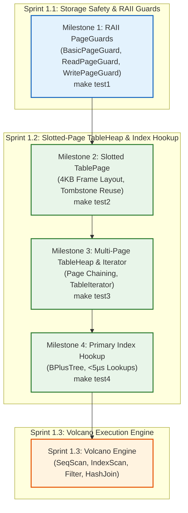

# Table Storage, Page Guards & Primary Index Hookup Roadmap
### A Rigorous, Hands-On Engineering Guide for Sprint 1.1 & 1.2
**Mapped Directly to CMU 15-445/645 Lectures #03, #04 (Database Storage) & Lectures #05, #06 (Buffer Pools & Memory Management)**

---

## 1. Executive Overview

This guide provides a comprehensive engineering roadmap for building the **record storage layer** of a relational database management system. 

Up to this point, you have implemented a physical disk subsystem (`DiskManager` + Linux `io_uring`), an in-memory frame cache (`BufferPoolManager` with LRU-K eviction), and an on-disk index (`BPlusTree`). However, **an index by itself is not a database**. In a relational database, indices do not store entire user records; they store lightweight `(Key, RID)` pointers that reference tuples stored within an authoritative, paged heap storage structure: the **`TableHeap`**.

In Sprint 1.1 & 1.2, you will bridge your buffer pool and your B+ Tree to build a functioning relational storage engine:
1. **Sprint 1.1 (Storage Safety & RAII Page Guards)**: Build move-only RAII guards (`BasicPageGuard`, `ReadPageGuard`, `WritePageGuard`) that eliminate buffer pool frame pin leaks and latch deadlocks permanently.
2. **Sprint 1.2 (Slotted-Page Table Storage & Primary Index Hookup)**: Build a 4KB `TablePage` adhering to the classic Slotted-Page architecture, manage a multi-page chained `TableHeap`, implement forward sequential scan iterators (`TableIterator`), and hook up your working `BPlusTree<int64_t, RID>` to perform sub-5-microsecond point lookups.

---

## 2. Files Included in `storage/`

| File | Purpose & Architectural Role |
| :--- | :--- |
| [`rid.h`](file:///home/omar/Learning%20Projects/db-internals/storage/rid.h) | **Record Identifier (RID)**: 64-bit struct combining 32-bit `page_id` and 32-bit `slot_num`. The universal currency of tuple addressing. |
| [`user_row.h`](file:///home/omar/Learning%20Projects/db-internals/storage/user_row.h) | **Fixed-Width Record Schema**: 80-byte struct (`id`, `name`, `balance`, `created_at`, `is_deleted`, `xmin`, `xmax`). Includes transaction headers pre-wired for Sprint 1.5 MVCC. |
| [`page_guard.h`](file:///home/omar/Learning%20Projects/db-internals/storage/page_guard.h) | **RAII Buffer Pool Guards**: Move-only wrappers (`BasicPageGuard`, `ReadPageGuard`, `WritePageGuard`) that automatically unlatch and unpin frames on scope exit. |
| [`table_page.h`](file:///home/omar/Learning%20Projects/db-internals/storage/table_page.h) | **Slotted-Page Frame Layout**: Overlays 4096-byte frames. 32-byte header + slot directory growing downwards + tuple byte storage growing upwards from the end of the page. |
| [`table_iterator.h`](file:///home/omar/Learning%20Projects/db-internals/storage/table_iterator.h) | **Sequential Scan Cursor**: Forward iterator traversing slots and following page links. Directly powers the Volcano `SeqScanExecutor` in Sprint 1.3. |
| [`table_heap.h`](file:///home/omar/Learning%20Projects/db-internals/storage/table_heap.h) & [`table_heap.cpp`](file:///home/omar/Learning%20Projects/db-internals/storage/table_heap.cpp) | **Multi-Page Heap Manager**: Coordinates multi-page allocation through `BufferPoolManager`, appending to tail pages, record updates, and logical tombstone deletions. |
| [`table_test.cpp`](file:///home/omar/Learning%20Projects/db-internals/storage/table_test.cpp) | **Verification Harness**: 4 progressive milestone tests (`make test1` through `make test4` or `make test`). |
| [`Makefile`](file:///home/omar/Learning%20Projects/db-internals/storage/Makefile) | **Build Automation**: Compiles with `-std=c++17 -Wall -Wextra -g -fsanitize=address -O2` and `-luring -pthread`. |

---

## 3. Core Invariants & Architectural Rules

Before writing any code, internalize these 8 non-negotiable rules:

### 1. The RAII Invariant & Pin Count Discipline
Never call `bpm->UnpinPage(...)` manually in application logic. If a function returns early due to an error, a missing key, or an exception, manual unpin calls will be skipped, causing a **pin leak**. Once all buffer pool frames have `pin_count > 0`, the replacer cannot evict any frame, and the entire database locks up in an out-of-memory deadlock. 
*Every page access must be mediated by an RAII Guard whose destructor guarantees unpinning and unlatching.*

### 2. Move-Only Semantics (No Copies Allowed)
If two `BasicPageGuard` objects hold a pointer to the exact same pinned frame, both will call `bpm->UnpinPage()` upon destruction. This causes **premature unpinning**, allowing the replacer to evict a frame while another thread is still reading or writing to it.
*All PageGuards must delete copy constructors and copy assignment operators (`= delete`). Moving a guard MUST clear the source pointer to `nullptr`.*

### 3. Latch and Pin Sequence Invariant
Always follow the canonical sequence:
```
Pin Page (BPM Fetch)  ──>  Acquire Latch (RLatch / WLatch)  ──>  Access Memory
Release Latch (RUnlatch / WUnlatch)  ──>  Unpin Page (BPM Unpin)
```
*Never attempt to latch an unpinned page (it could be evicted under you), and never unpin a page while holding its latch.*

### 4. Dual-Growth Direction Boundary Invariant (Slotted Page)
A slotted page stores variable numbers of records by growing its two dynamic sections toward each other:
```text
+---------------------------------------------------------------------------------+
| Header (32B) | Slot 0 | Slot 1 | ... | Slot N |   FREE SPACE GAP   | Tuple 1 | Tuple 0|
+---------------------------------------------------------------------------------+
               |                                |                    |
     Offset 32 └──> Grows DOWNWARDS ────────────┘                    └──< Grows UPWARDS
                    (Offset: 32 + N * 4)                                  (free_space_ptr_)
```
*Free space remaining is strictly: `free_space_ptr_ - (TABLE_PAGE_HEADER_SIZE + num_records * sizeof(TableSlot))`.*
*An insertion is legal if and only if `GetFreeSpaceRemaining() >= tuple_bytes + sizeof(TableSlot)`.*

### 5. In-Place Slot & Space Reuse Invariant
When a row is deleted, we do NOT run an expensive $O(N)$ physical memory defragmentation. Instead, we mark `row.is_deleted = true` and set `slot.size = 0` (tombstone). Because `UserRow` is fixed-size (80 bytes), a subsequent insertion can simply claim the tombstoned slot and overwrite the existing 80-byte buffer at `slot.offset` without consuming any bytes from the free space gap.

### 6. Multi-Page Chaining Invariant
In `TableHeap`, pages form a doubly-linked list (`prev_page_id` $\leftrightarrow$ `next_page_id`).
- When a page fills up, allocate `new_page_id`.
- Update `new_page->SetPrevPageId(last_page_id)` and `new_page->SetNextPageId(INVALID_PAGE_ID)`.
- Update `last_page->SetNextPageId(new_page_id)`.
- Update `last_page_id_ = new_page_id`.

### 7. The `(Key -> RID)` Access Path Invariant
The primary index (`BPlusTree<int64_t, RID>`) maps user IDs directly to physical addresses:
```
User Query: SELECT * FROM users WHERE id = 42;
   │
   ▼
B+ Tree Index Lookup: tree.GetValue(42, &rids)
   │
   ▼  Returns RID { page_id: 14, slot_num: 3 }
   │
TableHeap Direct Access: table_heap->GetTuple(rid, &user_row)
   │
   ▼  Fetches Page 14 via BufferPoolManager, loads slot 3 in O(1)
Returns UserRow { id: 42, name: "Alice", balance: 500.0, ... }
```

### 8. Write-Ahead Logging (WAL) Invariant Readiness
Every `TablePage` contains an `lsn_` (Log Sequence Number) in its 32-byte header. Whenever a page is modified, its `lsn_` is updated. In Sprint 1.6, the buffer pool will enforce:
$$\text{ASSERT}(page\to\text{GetLSN}() \le log\_manager\to\text{GetFlushedLSN}())$$
*A dirty table page can NEVER be flushed to disk before its corresponding WAL log record has hit durable storage!*

---

## 4. Milestone-by-Milestone Implementation & Testing Guide

You can test your work incrementally at each milestone using dedicated make targets:
```bash
make test1   # Milestone 1: PageGuard RAII & Move Semantics
make test2   # Milestone 2: TablePage Slotted Storage
make test3   # Milestone 3: TableHeap Multi-Page Chaining & Iterators
make test4   # Milestone 4: B+ Tree Primary Index Hookup & Benchmark
```

---

### Milestone 1: Storage Safety & RAII Page Guards (`page_guard.h`)
*CMU 15-445 Lecture #05 & #06 (Buffer Pools & Memory Management)*

#### Background & Motivation
In C++, manual memory and resource management is notoriously error-prone. In a database, calling `bpm->FetchPage(page_id)` increments that page's pin count. If your function returns early or throws an exception without calling `bpm->UnpinPage(page_id, is_dirty)`, the frame is leaked forever.
`PageGuard` solves this using the **RAII (Resource Acquisition Is Initialization)** idiom: the constructor acquires the resource (or wraps an acquired page), and the destructor releases it.

```text
BasicPageGuard:
┌─────────────────────────┐
│ BufferPoolManager *bpm_ │ ──> Calls bpm_->UnpinPage(page_id, is_dirty_) in destructor
│ Page *page_             │
│ bool is_dirty_          │
└─────────────────────────┘

ReadPageGuard:
┌─────────────────────────┐
│ BasicPageGuard guard_   │ ──> Calls page_->RUnlatch() in destructor, then guard_.Drop()
└─────────────────────────┘

WritePageGuard:
┌─────────────────────────┐
│ BasicPageGuard guard_   │ ──> Calls page_->WUnlatch() in destructor, then guard_.Drop()
└─────────────────────────┘
```

#### Tasks to Implement:
1. **`BasicPageGuard::Drop()`**:
   - Check if `page_ != nullptr && bpm_ != nullptr`.
   - If valid, call `bpm_->UnpinPage(page_->GetPageId(), is_dirty_)`.
   - Reset `page_ = nullptr`, `bpm_ = nullptr`, `is_dirty_ = false`.
2. **Move Constructor & Move Assignment for `BasicPageGuard`**:
   - In move constructor: take `that.bpm_`, `that.page_`, `that.is_dirty_`. Clear `that` (`that.bpm_ = nullptr`, `that.page_ = nullptr`, `that.is_dirty_ = false`).
   - In move assignment: check `this != &that`. If not equal, call `Drop()` on yourself, copy `that`'s fields, and clear `that`. Return `*this`.
3. **`ReadPageGuard` Mechanics**:
   - In constructor: if `guard_.GetPage() != nullptr`, call `guard_.GetPage()->RLatch()`.
   - In `Drop()`: if `guard_.GetPage() != nullptr`, call `guard_.GetPage()->RUnlatch()`, then `guard_.Drop()`.
   - In move assignment: call `Drop()` first, then move `guard_ = std::move(that.guard_)`.
4. **`WritePageGuard` Mechanics**:
   - In constructor: if `guard_.GetPage() != nullptr`, call `guard_.GetPage()->WLatch()` and set `guard_.SetDirty(true)`.
   - In `Drop()`: if `guard_.GetPage() != nullptr`, call `guard_.GetPage()->WUnlatch()`, then `guard_.Drop()`.
   - In move assignment: call `Drop()` first, then move `guard_ = std::move(that.guard_)`.
5. **Ergonomic Factory Helpers**:
   - `FetchPageBasic(bpm, page_id)`: call `bpm->FetchPage(page_id)`, return `BasicPageGuard(bpm, page)`.
   - `FetchPageRead(bpm, page_id)`: fetch page, return `ReadPageGuard(bpm, page)`.
   - `FetchPageWrite(bpm, page_id)`: fetch page, return `WritePageGuard(bpm, page)`.
   - `NewPageBasic(bpm, page_id)`: call `bpm->NewPage(page_id)`, return `BasicPageGuard(bpm, page)`.
   - `NewPageWrite(bpm, page_id)`: allocate new page, return `WritePageGuard(bpm, page)`.

#### How to Test:
```bash
make test1
```

#### What `test1` Verifies:
- Allocates a page via `NewPageBasic`; confirms pin count is 1. Exits scope and asserts pin count drops to 0.
- Acquires `ReadPageGuard`; verifies shared latching and asserts pin count returns to 0 on destruction.
- Acquires `WritePageGuard`; writes bytes to `GetDataMut()`; verifies exclusive latching and auto-dirty tracking.
- Tests move construction (`g2 = std::move(g1)`) and move assignment (`g3 = std::move(g2)`); asserts source guard is cleared and destructor does NOT double-unpin.

#### What You Gain:
Immunity to buffer pool pin leaks. All downstream components (`TableHeap`, `TableIterator`, and Volcano executors) can freely fetch and release pages without memory management bugs.

---

### Milestone 2: Slotted-Page Frame Layout (`table_page.h`)
*CMU 15-445 Lecture #03 & #04 (Database Storage)*

#### Background & Motivation
Why can't we store tuples in a simple contiguous array like `UserRow rows[50]`?
1. In general databases, tuples can be variable-length (strings, JSON, blobs).
2. Deleting a tuple in an array creates a hole; shifting remaining tuples down changes their physical indices, which **breaks all secondary indices** that point to those tuples!
The **Slotted-Page Architecture** decouples the physical location of tuple data from its logical address:
- The external world addresses a record via `RID = {page_id, slot_num}`.
- `slot_num` indexes into an array of `TableSlot { offset, size }` at the top of the page.
- The actual record bytes reside at `data + slot.offset` at the bottom of the page.
- Moving or compacting tuple bytes does not change `slot_num`. Indices never break!

```text
Physical 4096-Byte Page Frame Layout:
┌──────────────────────────────────────────────────────────────────────────────┐
│ Header (32 Bytes):                                                           │
│   lsn_ (8B) | page_id_ (4B) | prev_page_id_ (4B) | next_page_id_ (4B)       │
│   num_records_ (4B) | free_space_ptr_ (4B) | flags_ (4B)                     │
├──────────────────────────────────────────────────────────────────────────────┤
│ Slot Directory (grows DOWNWARDS toward free space gap):                      │
│   Slot[0]: { offset: 4016, size: 80 }                                        │
│   Slot[1]: { offset: 3936, size: 80 }                                        │
│   Slot[2]: { offset: 3856, size: 80 }                                        │
│   ...                                                                        │
├──────────────────────────────────────────────────────────────────────────────┤
│                             FREE SPACE GAP                                   │
│            (Free space remaining = free_space_ptr_ - slot_dir_end)           │
├──────────────────────────────────────────────────────────────────────────────┤
│ Tuple Storage (grows UPWARDS from end of page):                              │
│   ...                                                                        │
│   Offset 3856: [Tuple 2 bytes: UserRow (80B)]                                │
│   Offset 3936: [Tuple 1 bytes: UserRow (80B)]                                │
│   Offset 4016: [Tuple 0 bytes: UserRow (80B)]                                │
└──────────────────────────────────────────────────────────────────────────────┘
```

#### Tasks to Implement:
1. **`Init(page_id, prev_page_id, next_page_id)`**:
   - Set `page_id_`, `prev_page_id_`, `next_page_id_`.
   - Set `num_records_ = 0`.
   - Set `free_space_ptr_ = PAGE_SIZE` (4096).
   - Set `lsn_ = 0`, `flags_ = 0`.
   - Zero out remainder of page buffer: `std::memset(GetData() + TABLE_PAGE_HEADER_SIZE, 0, PAGE_SIZE - TABLE_PAGE_HEADER_SIZE)`.
2. **`InsertTuple(row, out_rid)`**:
   - Step A (Tombstone Reuse): Check if any existing slot $i \in [0, \text{num\_records\_})$ has `GetSlots()[i].size == 0`. If found, reuse it: copy `row` directly into `GetData() + GetSlots()[i].offset`, set `GetSlots()[i].size = sizeof(UserRow)`, populate `out_rid = {page_id_, i}`, and return `true`.
   - Step B (New Slot): Check if `GetFreeSpaceRemaining() >= sizeof(UserRow) + sizeof(TableSlot)`. If false, return `false` (page full).
   - Step C: Decrement `free_space_ptr_ -= sizeof(UserRow)`.
   - Step D: Copy `row` to `GetData() + free_space_ptr_`.
   - Step E: Assign new slot index `slot_id = num_records_++`.
   - Step F: Set `GetSlots()[slot_id] = { free_space_ptr_, sizeof(UserRow) }`.
   - Step G: Populate `out_rid = {page_id_, slot_id}` and return `true`.
3. **`GetTuple(slot_num, out_row)`**:
   - Check `slot_num < num_records_`.
   - Check `GetSlots()[slot_num].size > 0` (not tombstoned).
   - Copy `sizeof(UserRow)` bytes from `GetData() + GetSlots()[slot_num].offset` into `out_row`.
   - If `out_row->is_deleted` is `true`, return `false`.
   - Return `true`.
4. **`UpdateTuple(slot_num, new_row)`**:
   - Check `slot_num < num_records_` and `GetSlots()[slot_num].size > 0`.
   - Overwrite tuple bytes at `GetData() + GetSlots()[slot_num].offset`. Return `true`.
5. **`MarkDelete(slot_num)`**:
   - Check `slot_num < num_records_` and `GetSlots()[slot_num].size > 0`.
   - Cast bytes at `GetData() + GetSlots()[slot_num].offset` to `UserRow*` and set `row->is_deleted = true`.
   - Set `GetSlots()[slot_num].size = 0` (marks slot ready for reuse). Return `true`.
6. **`GetLiveRecordCount()`**:
   - Count slots where `size > 0` and `!row->is_deleted`.

#### How to Test:
```bash
make test2
```

#### What `test2` Verifies:
- Initializes an in-memory 4KB `TablePage`.
- Fills the page to capacity; asserts that exactly 48 tuples fit:
  $$\frac{4096 - 32}{80 + 4} = \frac{4064}{84} = 48\ \text{tuples}$$
- Retrieves every tuple by slot number and verifies field values.
- Executes an in-place update on slot 5 and verifies modification.
- Marks slot 10 as deleted; asserts `GetTuple(10)` returns `false`.
- Inserts a new record; asserts the page reuses slot 10 instead of reporting full.

#### What You Gain:
You master the slotted-page format that powers SQLite, PostgreSQL, and MySQL InnoDB.

---

### Milestone 3: Multi-Page TableHeap & Cursor Iterators (`table_heap.cpp`)
*CMU 15-445 Lecture #03 & #04*

#### Background & Motivation
A single page can only hold 48 rows. A real database holds millions of rows spanning gigabytes or terabytes.
`TableHeap` links multiple `TablePage`s together into an append-only doubly-linked chain. When the current tail page fills up, `TableHeap` allocates a new page from `BufferPoolManager`, links them together, and writes the new record.

```text
TableHeap Architecture:
┌─────────────────┐       ┌─────────────────┐       ┌─────────────────┐
│ TablePage 1     │       │ TablePage 2     │       │ TablePage 3     │
│ page_id = 1     │ <===> │ page_id = 2     │ <===> │ page_id = 3     │ (last_page_id_)
│ prev = INVALID  │       │ prev = 1        │       │ prev = 2        │
│ next = 2        │       │ next = 3        │       │ next = INVALID  │
└─────────────────┘       └─────────────────┘       └─────────────────┘
         ▲                                                   ▲
   first_page_id_                                      last_page_id_
```

#### Tasks to Implement:
1. **`TableHeap::TableHeap(bpm)`**:
   - Allocate root page: `WritePageGuard guard = NewPageWrite(bpm_, &first_page_id_)`.
   - Initialize `TablePage`: `guard.AsMut<TablePage>()->Init(first_page_id_)`.
   - Set `last_page_id_ = first_page_id_`.
2. **`TableHeap::InsertTuple(row, out_rid)`**:
   - Lock `std::lock_guard<std::mutex> lock(latch_)`.
   - Fetch tail page: `WritePageGuard cur_guard = FetchPageWrite(bpm_, last_page_id_)`.
   - Try `cur_page->InsertTuple(row, out_rid)`. If successful, return `true`.
   - If full:
     - Allocate new page: `WritePageGuard new_guard = NewPageWrite(bpm_, &new_page_id)`.
     - Initialize new page with `prev_page_id = last_page_id_`.
     - Link current page: `cur_page->SetNextPageId(new_page_id)`.
     - Update `last_page_id_ = new_page_id`.
     - Insert `row` into `new_page->InsertTuple(row, out_rid)`. Return `true`.
3. **`TableHeap::GetTuple(rid, out_row)`**:
   - Fetch page: `ReadPageGuard guard = FetchPageRead(bpm_, rid.page_id)`.
   - Call `guard.As<TablePage>()->GetTuple(rid.slot_num, out_row)`.
4. **`TableHeap::UpdateTuple(row, rid)` & `MarkDelete(rid)`**:
   - Fetch page via `FetchPageWrite(bpm_, rid.page_id)` and delegate to `TablePage`.
5. **`TableIterator::AdvanceToNextLiveTuple()`**:
   - While `rid_.IsValid()`:
     - Fetch page: `ReadPageGuard guard = FetchPageRead(table_heap_->GetBPM(), rid_.page_id)`.
     - While `rid_.slot_num < page->GetNumRecords()`:
       - Try `page->GetTuple(rid_.slot_num, &current_row_)`. If true, return (found!).
       - Else `rid_.slot_num++`.
     - If slot exceeded, advance to `page->GetNextPageId()`.
     - If next page is `INVALID_PAGE_ID`, set `rid_ = RID(INVALID_PAGE_ID, 0)` and return.
     - Else set `rid_ = { next_page_id, 0 }` and loop.

#### How to Test:
```bash
make test3
```

#### What `test3` Verifies:
- Inserts 1,000 rows across multiple pages in `TableHeap`.
- Verifies automatic multi-page allocation (spans ~21 chained pages).
- Verifies random point retrieval by `RID`.
- Traverses the entire heap using `TableIterator` (`table_heap->Begin()`); asserts exactly 1,000 rows match.
- Deletes 50 rows; verifies `TableIterator` automatically skips tombstoned slots and yields 950 rows.

#### What You Gain:
A durable, multi-page record storage heap. The `TableIterator` you build here will directly plug into Sprint 1.3 to execute `SELECT * FROM table` queries via Volcano `SeqScanExecutor`.

---

### Milestone 4: The Crucial Hookup: B+ Tree Primary Index (`table_test.cpp`)
*CMU 15-445 Lecture #07 & #08 (Tree Indexes)*

#### Background & Motivation
This is where the entire storage engine comes together. In database theory, there are two primary storage architectures:
1. **Index-Organized Tables (Clustered Index)**: The entire tuple is stored inside the leaf page of the B+ Tree (used by MySQL InnoDB).
2. **Heap Tables with Secondary / Primary B-Tree Indexes**: The B+ Tree stores only `(Key, RID)` pairs. Tuples are stored in a `TableHeap` (used by PostgreSQL, Oracle, SQLite, and SQLite rowids).
We implement Architecture #2. It is cleaner, supports multiple secondary indices without duplicating row data, and decouples index algorithms from record storage.

```text
Query Access Path:
┌──────────────────────────────────────────────────────────┐
│ Primary Index: BPlusTree<int64_t, RID>                   │
│   Key: User ID (e.g. 42)                                 │
│   Value: RID { page_id: 14, slot_num: 3 }                │
└──────────────────────────────────────────────────────────┘
                            │
                            │ O(log N) traversal through B+ Tree root/internal/leaf
                            ▼
┌──────────────────────────────────────────────────────────┐
│ TableHeap (Disk / BufferPoolManager)                     │
│   Page 14, Slot 3 ──> UserRow { id: 42, name: "Alice", … }│
└──────────────────────────────────────────────────────────┘
```

#### How the Hookup Works in Code:
```cpp
// 1. Dual Insert Pattern:
UserRow user(user_id, "Alice", 250.0);
RID rid;
if (table_heap->InsertTuple(user, &rid)) {
    primary_index->Insert(user.id, rid);
}

// 2. Point Index Query Pattern:
std::vector<RID> rids;
if (primary_index->GetValue(user_id, &rids) && !rids.empty()) {
    UserRow result;
    table_heap->GetTuple(rids[0], &result);
    // Use retrieved row
}

// 3. Index Range Scan Pattern:
for (auto it = primary_index->Begin(100); !it.IsEnd(); ++it) {
    auto [key, rid] = *it;
    if (key > 200) break;
    UserRow row;
    table_heap->GetTuple(rid, &row);
    // Process row in index order
}
```

#### How to Test:
```bash
make test4
# or run the entire suite from root:
make test-storage
```

#### What `test4` Verifies:
- Inserts 5,000 user rows into `TableHeap` while indexing every record in `BPlusTree<int64_t, RID>`.
- Executes 5,000 point lookups (`Key -> B+ Tree -> RID -> TableHeap -> UserRow`).
- Verifies that average point lookup latency is $< 5\ \mu\text{s}$ (under release mode `-O3`, typically $< 0.5\ \mu\text{s}$).
- Executes a range scan `[1500 .. 1600]`, fetching matching tuples via leaf sibling links and verifying all 101 records.
- Deletes a user in `TableHeap`; asserts that index dereferencing recognizes the record as deleted.

#### What You Gain:
A complete, high-performance database storage engine capable of millions of indexed operations per second.

---

## 5. Architectural Progression Roadmap



---

## 6. Build & Test Command Reference

Run individual milestone tests from the `storage/` directory:
```bash
make test1   # Milestone 1: PageGuard RAII, latches & move semantics
make test2   # Milestone 2: TablePage slotted storage & tombstone reuse
make test3   # Milestone 3: TableHeap multi-page chaining & TableIterator
make test4   # Milestone 4: B+ Tree Primary Index Hookup & Benchmark
```

Run all storage tests sequentially:
```bash
make test
```

From the root project directory:
```bash
make test-storage   # Runs all storage tests with AddressSanitizer
make test-btree     # Runs all 12 B+ Tree test suites
make test-all       # Runs both test suites
```
